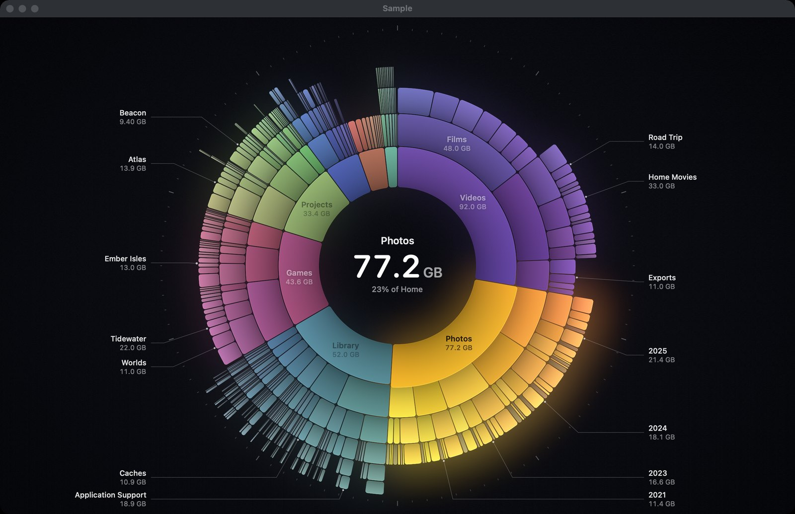

# SunburstKit

A sunburst chart for macOS, drawn with Metal. Any tree, such as a disk, a budget or a library, shown as rings around a
middle, each piece's angle set by its size. Point at a piece to light its branch, click to zoom into it, and click the
middle to go back out.



<sub>The pictures show the example app's made-up sample.</sub>

- **One line to use.** `Sunburst(tree)` gives the ring, names on and beside it, a readout in the middle, pointing, zooming,
  keys and VoiceOver.
- **Made of parts.** A chart is a centre, thin bands, rings and a dial, each with one meaning wherever it's used, so whoever
  has read one chart can read another. You choose the parts; the kit keeps what each one means.
- **Any tree.** It doesn't own your data. Hand it the items you already have (`ItemTree`), or answer a small protocol from a
  tree of your own, and you decide what the colours mean, what's marked and what a click opens.
- **Fast.** The layout of a million-file disk's top six rings, about a thousand pieces, takes half a millisecond on an
  Apple silicon Mac, and a photo library's 80,000 files in one folder take 0.4 ms. The layout is generic and `@inlinable`,
  so your build specialises it for your own tree. Every piece is one instanced quad
  shaped on the GPU, so drawing barely depends on how many there are, and the ring only draws while something moves, on a
  thread of its own.
- **Moves well.** One spring carries every change: a zoom, new sizes arriving while something is measured, new colours.
  Pieces glide from their old place to their new one, and with Reduce Motion they dissolve in place instead.
- **Looks good anywhere.** Colours are worked out in OKLab, each branch gets its own hue from the whole spectrum, and the
  glow uses the extra brightness of an XDR screen when there is one.
- **Can be driven and read from code.** Everything a person does with the pointer has a call, the chart can describe itself
  in words, and it can draw a picture of itself without a window. That's also how agents use it (see `SunburstAgents`).

Requirements: macOS 14 or later, Swift 6.2 or later. No dependencies.

## Install

Add this repository's URL as a package dependency, up to the next minor version from 0.3.0: in Xcode with File › Add
Package Dependencies… (Dependency Rule: Up to Next Minor Version), or in `Package.swift` with `.package(url:_:)` and
`.upToNextMinor(from: "0.3.0")`. Before 1.0, a patch such as 0.3.1 never breaks your code; a minor version such as 0.4.0
may, and its notes say what. Coming from 0.2, see [Moving from 0.2](#moving-from-02). Then add `SunburstKit` to your target's dependencies, and `SunburstAgents` too if you want
agents.

## Quick start

```swift
import SunburstKit
import SwiftUI

struct Cost {
    var name: String
    var cents = 0
    var parts: [Cost] = []
}

struct BudgetView: View {
    let tree: ItemTree<Cost>

    init(budget: Cost) {
        tree = ItemTree(budget, name: \.name, size: \.cents, children: \.parts)
    }

    var body: some View {
        Sunburst(tree, sizeText: { "$\($0 / 100)" })
    }
}
```

`ItemTree` takes items of any type: what each is called, its own size in whole units (bytes, cents, a count), and what's
inside it. A folder's size is everything in it added up. `tree[node]` gives back the item a node stands for, and
`tree.nodes(where:)` finds nodes by their items. For a tree of your own, such as one read from disk as it's measured,
answer `SunburstTree` (below) and say what each node is called: `Sunburst(tree, name: { tree.name(of: $0) })`.

Sizes are written in bytes ("4.20 GB") unless you pass `sizeText:`. To write something else for a node, such as films sized
by how many there are but shown in bytes, pass `valueText:`. To show a tree that changes, or to drive the chart from code,
keep a `SunburstChart` and show that:

```swift
@State private var chart = SunburstChart(tree: tree)   // an ItemTree; a tree of your own also takes name:

var body: some View {
    Sunburst(chart)
}

// Anywhere on the main actor:
chart.zoom(into: node)              // into a node; a node with nothing inside is opened instead (onOpen)
chart.zoomOut()                     // one level back out
chart.highlight([a, b], tint: c)    // light these and the way out to them, in one colour, until the pointer is on the ring
chart.marked = [selected]           // drawn striped
chart.valueText = { node in … }     // a node's own text in place of its size
chart.tree = updated                // the same tree with new sizes, as often as they come: everything glides
chart.show(otherTree)               // a different tree: back to its root
chart.onOpen = { node in … }        // a click on a file, say
chart.onKey = { event in … }        // your keys first; return true when handled (Escape and Delete back out)
chart.menu = { node in … }          // a right-click menu, such as Reveal in Finder
chart.onCommandClick = { node in … }
chart.takesKeyboardFocus = true     // keys work without a click first
```

A chart is shown in one view at a time, so give each window its own. What the pointer is on stays lit while sizes,
marks and colours change under it.

Two example apps, each run with `swift run` in its folder:

- [FolderMap](Examples/FolderMap) is a complete Mac app: it shows a folder, or a made-up sample shaped like a real home
  folder, and lets agents in when you ask.
- [Budget](Examples/Budget) is a month's money in the same parts as a disk: fixed and variable costs in a thin band, the
  costs in rings outside it, and what isn't spent yet as room, a plain wedge closing the circle.


## Parts


Every chart is made of the same parts, from the middle out, and each always means the same thing:

| Part | Where | Means |
| --- | --- | --- |
| Centre | the hole | the one number that matters now: the kit's readout, or anything of your own |
| Split | the first level | several wholes sharing the circle, such as two disks compared: equal halves, each its own 100% |
| Bands | thin levels just outside the centre | what the whole is made of: read it, don't act on it |
| Rings | the thick levels going out | the things, one level deeper each ring |
| Dial | outside the last ring | the scale: a mark every 1%, a longer one every 10%, of the circle or of each side |

You describe a chart's parts in one value, `SunburstParts`, and hand it over whole, so a chart can swap all of them at
once (another view, more rings) and every piece glides to its new place:

```swift
// A whole disk: what it's made of in a thin band, then six rings of folders.
chart.parts = SunburstParts(bands: [.init()], rings: .init(RingSizes(depth: 6)))

// Two disks compared: each side its own whole, its folders ordered and cut by where their files are.
chart.parts = SunburstParts(split: .band, rings: .init(order: .byGroup), dial: .init(counts: .eachSide))

// The plain chart, rings and a dial, is the default.
chart.setParts(SunburstParts(), animated: false)
```

Each level of the tree goes to one part: the split takes the first level, each band the next, and the rings the rest.

- **What's yours to choose:** whether to have a split, how many bands and which levels they take, how many rings and how
  thick (`RingSizes`, `RingStyle`), how the rings order and cut what's in them (`Rings.order`, `keep`, `cuts`), and whether
  there's a dial and what it counts.
- **What's fixed, and why:** a band sits inside the rings, because a chart reads from the whole in the middle to the detail
  at the edge. It's thin, so context never competes with the things, and its segments aren't named: no name would fit, and
  the centre says what's pointed at. Zooming into one of its segments removes it, since you're inside that part now. A split
  drawn as a band (`.band`) frames the rings; drawn as a ring (`.ring`) it writes each side's name on it.

## Your tree: `SunburstTree`

Nodes are `UInt32` numbers. Node 0 is the root, and 0 as a child or a sibling means there is none. Children are listed
biggest first, and things of the same size are drawn in the order you list them, such as by name. The tree says what
exists, how big it is and what it is; how it's drawn is the chart's parts.

| Member | What it says |
| --- | --- |
| `firstChild(of:)`, `nextSibling(of:)`, `parent(of:)` | The shape of the tree |
| `size(of:)` | Everything in the node: sets its angle |
| `ownSize(of:)` | What the node holds outside its children, drawn with what's too small to draw on its own |
| `isFolder(_:)` | Only folders chain: a folder that's nearly all one subfolder is drawn as one piece with it |
| `nameKey(of:)` | A number from the name, the same from one tree to the next, so pieces glide to their new places |

Optional, with defaults:

| Member | Default | What it says |
| --- | --- | --- |
| `role(of:)` | a container if it's a folder, else an item | What the node is (`SunburstRole`), which sets its look anywhere: `.container`, `.item`, `.room` (room not used, such as free space: a plain wedge around the whole), `.unreadable` (hatched), `.gone` (an outline, where it was) |
| `isShared(_:)` | false | Being shared, such as a file being seeded: a bright dashed outer edge, over whatever its role draws |
| `group(of:)` | nil | Which group the node is in, such as a place, for rings drawn by group (`Rings.order = .byGroup`) |
| `isStillGrowing(_:)` | false | Still being measured: it doesn't chain yet |
| `hasNode(_:)` | looks from the root down | Whether the tree has a node with this number, checked before a number from an agent is used; answer at once if your nodes are numbered in a row |
| `isInside(_:_:)` | walks up from the node | Whether a node is a folder or inside it; answer at once if your nodes are numbered depth first |
| `branches(_:)` | a set that walks up from each node it's asked about | Some nodes as a set for lighting (`SunburstNodeSet`), asked about once for every piece; a tree numbered depth first answers from ranges |

## Colours

By default each branch in view gets its own colour from the whole spectrum, a golden angle from the one before, and
everything inside it stays close to that colour, a little lighter each ring out (`BranchColours`). To colour by something
else, such as a file's kind, give the chart a colorer: a colour in linear Display P3 for each node. `Lab` makes good ones.

```swift
chart.colours = { tree, focus in
    { node in Lab(lch: 0.7, 0.15, kindHue(of: node)).linearP3 }
}
```

`BranchColours` can also be painted branch by branch, for rules of your own: `paint(_:hue:)`, `paintQuietly(_:)` for
something that should stay in the background, and `set(_:_:)`. So that a branch keeps its colour however sizes change, a
`HueMemory` remembers which hue each name had; you keep its `indices` between launches:

```swift
var hues = HueMemory(saved)                       // [name: index], as you kept it
for branch in branches { colours.paint(branch, hue: hues.hue(for: name(branch), after: previous)) }
if hues.changed { save(hues.indices) }
```

## Hooks

The chart does what every ring does the same way. What your app does its own way, it says through hooks:

```swift
chart.isMarked = { node in plan.contains(node) }          // striped, asked per piece: for a selection too big to list
chart.alsoLight = { node in .init(copies(of: node), gathered: .shown, tint: setColour) }   // more lights with what's pointed at
chart.alsoLight = { _ in .init(tint: green, tints: { backedUp.contains($0) }) }  // or, in what's pointed at, colour some
chart.onPoint = { pointed in panel.show(pointed?.node) }  // what's under the pointer, as it changes
chart.onClick = { click in                                 // return true when handled, so the chart doesn't zoom
    guard case .piece(let pointed) = click.target else { return false }
    return openIfFile(pointed.node)
}
chart.hold(node); chart.hold(nil)                         // keep a piece lit while its card is open, then let go
chart.highlight(copies, primary: this, tint: setColour)   // light these from a list, one of them most, while sizes change
chart.highlight { layout in videos(in: layout) }          // or what you work out from each picture (RingLight)
chart.refreshPointer()                                     // what's pointed at means something else now: say it again
chart.relabel(after: 0.05)                                 // what's named changed in a way only you know: name again
chart.namer = MyNames()                                    // what's named, on the ring and at the sides (SunburstNamer)
chart.calm = 0.55; chart.glow = 0.35                      // how much pieces at rest hold back, and glow

Sunburst(chart) { readout, diameter in                     // a centre of your own, in the kit's slot
    MyCentre(diameter: diameter)                           // SunburstNumber reads like the kit's big number
}
```


## Reading it from code

`chart.summary(limit:)` says what's on the ring: the node in the middle, and the biggest pieces with their names, sizes,
shares and where they sit, as a `Codable` value. `chart.picture(width:height:)` draws the ring into a `CGImage` off screen,
without a window: for tests, exports, or an agent that wants to look. With `dithered: false` it leaves out the faint
noise that keeps dark gradients smooth on screen, for a PNG about half the size.

```swift
let summary = chart.summary(limit: 10)
print(summary.name, summary.sizeText)                      // Home 332 GB
for piece in summary.pieces { print(piece.name, piece.share) }

let image = chart.picture(width: 1600, height: 1200)       // nil without a GPU
```

## Building your own

`Sunburst` is made of parts you can use directly, for a view of your own:

- `RingLayout.build(tree:focus:parts:colorer:marked:)` turns part of a tree into `Piece`s, depth first, in the chart's
  parts; `levels` says which part each level is. `piece(of:)`, `hit(angle:radius:)` and `extent(of:)` find pieces in it,
  and `light(_:in:)` says what lights up for a set of nodes, with everything inside them (`RingLight`), asking the tree's
  own set of them (`branches(_:)`).
- `SunburstEngine` holds the picture on screen and everything that moves: `apply(_:_:)` with a `RingTransition`,
  `setEmphasis(primary:related:ancestors:tint:)` to light pieces, `setCalm(_:)`, `setGlow(_:)`, `showsScale`.
- `SunburstView` is the `NSView` that draws it, with callbacks for the pointer, keys and VoiceOver; `RingPlace` tells it
  where the ring is on every frame of a SwiftUI animation.
- `LabelPlacer` works out where names fit, inside pieces and beside the ring, and `SunburstLabels` shows them.

## Agents

`SunburstAgents`, a second product in this package, lets AI agents such as Claude Code look at a chart and point at things
on it, over MCP. It's separate, so an app that doesn't use it compiles none of it. Turning it on takes a few lines:

```swift
import SunburstAgents

extension AgentHost {
    static let myApp = AgentHost(
        name: "FolderMap", version: "1.0",
        instructions: "FolderMap shows a folder as a sunburst. Call chart_summary to see what's on it, and chart_find to find something by name.",
        folder: URL.applicationSupportDirectory.appendingPathComponent("FolderMap"),
        tools: SunburstAgentTools.tools)        // + any tools of your own
}

let door = AgentDoor.open(.myApp) { call in
    try SunburstAgentTools.answer(call, chart: chart)    // or answer your own tools first
}
```

and, as the first thing the program does, `AgentDoor.relayIfAsked(.myApp)`: an agent starts the app's program with
`--mcp`, and from then on that copy only relays between the agent and the running app. `AgentAccessView` shows that
command, ready to copy into an agent's settings (`AgentDoor.command`).

- **The user decides.** An agent gets nothing until the user allows it: `.agentQuestion(door)` asks in the app's window,
  and `AgentAccessView(door)` lists who's asking, who's allowed (to look, or to look and change what's shown), and what
  each agent did. Which program is on the other end, and who signed it, is read from the system, so an agent can't pass
  itself off as another program.
- **Nothing on the network.** The door is a socket file in the app's own folder that only the user can open.
- **The chart's tools:** `chart_summary` (what's on the ring, in words), `chart_find` (things by name anywhere in the
  tree), `chart_children` (what's inside a node), `chart_picture` (a PNG of it), `chart_zoom_in`, `chart_zoom_out`,
  `chart_highlight` and `chart_clear_highlight`. The last four change what the user sees, so an agent allowed only to look
  can't call them. An agent can zoom into or light anything it found, on the ring or not.
- **Your own tools** are `AgentTool`s beside them, answered in the same closure with an `AgentReply`: JSON, text or an
  image.

The example app has an Agents… button that does all of this.

## Moving from 0.2

0.3 moves how a tree is drawn out of the tree and into the chart's parts. The tree says what things are; the parts say how
the chart is made.

| 0.2 | 0.3 |
| --- | --- |
| `style(of:)` returning `PieceStyle` | `role(of:)` returning `SunburstRole`, and `isShared(_:)`; `Piece.style` is `Piece.role` and `isShared` |
| `hasBand` | `SunburstParts(bands: [.init()])` |
| `hasHalves`, `isHalf(_:)` | `SunburstParts(split: .ring)` (or `.band`): the root's things are the sides |
| `rootRank(of:)` | `Band(order: .ranked { ... })`; room and what can't be read come last by themselves |
| `isPlainShape(_:)` | `role(of:)` returning `.room` or `.unreadable`: around the whole, they close the circle as wedges |
| `hasGroups` | `Rings(order: .byGroup)`; `group(of:)` stays on the tree |
| `isAlwaysDrawn(_:)` | `Rings(keep:)` |
| `stretches(of:)` | `Rings(cuts:)` |
| `chart.sizes` | still there, as `chart.parts.rings.sizes` |
| `RingLayout.build(…, sizes:)`, `fill(…, style:)` | `build(…, parts:…)`, `fill(…, parts:)` |
| `freePiece` | `roomPiece` |
| `LabelPlacer.order(_:halvesFirst:)`, `inside(…halves:…)` | `order(_:)`, `inside(layout:order:area:named:name:)`: the layout knows its split |
| `Sunburst<Tree>` | `Sunburst<Tree, Centre>`, with the kit's centre by default |

A chart given the parts its 0.2 switches described draws what 0.2 drew, with two deliberate differences: `cuts` apply to
rings only, not to a band's or a split's segments; and around the whole, room and what can't be read always close the
circle as wedges, after everything else, with or without a band. `RingLayout.visibleChildren(tree:of:)` at the root lists
all the root's things, since a split is a part now rather than something the tree knows.

## Working on it

- `swift test` runs the tests. Tests that draw are skipped on a machine without a GPU.
- The shaders' source is `Sources/SunburstKit/Shaders.metal`. They're built into the package as a string, so an app needs no
  resources of its own: after changing them, run `Scripts/embed-shaders.sh`. A test fails until you do.

## Licence

MIT. See [LICENSE](LICENSE).
