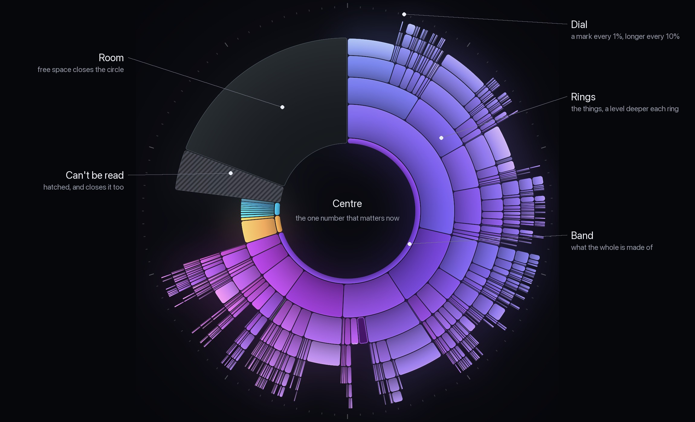

# SunburstKit

A sunburst chart for macOS, drawn with Metal. It shows any tree, such as a disk, a budget or a photo library, as rings
around a centre, with each segment's angle set by its size. Hover over a segment to highlight its branch, click it to zoom
in, and click the centre to zoom out.


<sub>The screenshots show the example app's sample data.</sub>

- A complete chart in one view: `Sunburst(tree)` includes labels, a readout in the centre, hover, click to zoom, keyboard
  navigation and VoiceOver
- Works with any tree: wrap your own items in `ItemTree`, or conform your own tree type to `SunburstTree`
- Built from standard parts, each with one meaning: a centre, a split, bands, rings and a dial ([Parts](#parts))
- Fast: lays out the top six rings of a million-file disk, about 1,000 segments, in 0.5 ms on Apple silicon, and 80,000
  files in one folder in 0.4 ms. The layout is generic and `@inlinable`, so it's specialised for your tree type. Each
  segment is one instanced quad on the GPU, and the chart only redraws while something moves, on its own thread
- Animated by a single spring: zooms, new sizes and new colours move every segment to its new place. With Reduce Motion,
  segments cross-fade instead
- Colours computed in OKLab, a distinct hue for each branch, and XDR brightness for highlights on displays that have it
- Scriptable: every pointer action has an API, the chart can describe itself as data and render itself off screen.
  `SunburstAgents` exposes this to AI agents

Requires macOS 14 or later and Swift 6.2 or later. No dependencies.

## Install

Add the package with Swift Package Manager, up to the next minor version:

```swift
.package(url: "<this repository's URL>", .upToNextMinor(from: "0.3.0"))
```

Then add `SunburstKit` to your target's dependencies, and `SunburstAgents` if you want agent access. In Xcode, use
File › Add Package Dependencies… with the rule Up to Next Minor Version.

Before 1.0, patch releases (such as 0.3.1) never break source compatibility; minor releases (such as 0.4.0) may, and their
notes say what changed. Upgrading from 0.2: see [Moving from 0.2](#moving-from-02).

## Quick start

```swift
import SunburstKit
import SwiftUI

struct Cost {
    var name: String
    var cents = 0
    var parts: [Cost] = []
}

struct BudgetView: View {
    let tree: ItemTree<Cost>

    init(budget: Cost) {
        tree = ItemTree(budget, name: \.name, size: \.cents, children: \.parts)
    }

    var body: some View {
        Sunburst(tree, sizeText: { "$\($0 / 100)" })
    }
}
```

`ItemTree` wraps items of any type, given each item's name, its own size in whole units (bytes, cents, a count) and its
children. A parent's size is its own size plus its children's. `tree[node]` returns the item for a node, and
`tree.nodes(where:)` finds nodes by item. For a tree type of your own, such as one that grows while a disk is scanned,
conform it to [`SunburstTree`](#your-tree-sunbursttree) and pass the names: `Sunburst(tree, name: { tree.name(of: $0) })`.

Sizes are shown in bytes ("4.20 GB") by default; pass `sizeText:` to format them differently. Pass `valueText:` to show
other text for a node, for example to size films by count but show their size in bytes. For a tree that changes, or to
control the chart from code, keep a `SunburstChart` and pass it to the view:

```swift
@State private var chart = SunburstChart(tree: tree)   // an ItemTree; your own tree type also takes name:

var body: some View {
    Sunburst(chart)
}

// On the main actor:
chart.zoom(into: node)              // zoom in; for a leaf, calls onOpen instead
chart.zoomOut()                     // zoom out one level
chart.highlight([a, b], tint: c)    // highlight nodes and their path from the centre, until the pointer is on the chart
chart.marked = [selected]           // drawn striped
chart.valueText = { node in … }     // text shown instead of a node's size
chart.tree = updated                // the same tree with new sizes, as often as they change; segments animate
chart.show(otherTree)               // a different tree, shown from its root
chart.onOpen = { node in … }        // a leaf was clicked, such as a file
chart.onKey = { event in … }        // your key handling first; return true if handled (Escape and Delete zoom out)
chart.menu = { node in … }          // context menu, such as Reveal in Finder
chart.onCommandClick = { node in … }
chart.takesKeyboardFocus = true     // accept keys without a click first
```

A chart can be shown in one view at a time, so give each window its own. The hovered segment stays highlighted while
sizes, marks and colours change.

Two example apps; run each with `swift run` in its folder:

- [FolderMap](Examples/FolderMap): a complete Mac app that shows a folder, or a sample shaped like a home folder, with
  optional agent access
- [Budget](Examples/Budget): a month's budget built from the same parts as a disk: fixed and variable costs in a band,
  the costs in rings outside it, and unspent money as an empty segment that closes the circle


## Parts



Every chart is built from the same parts, from the centre out, and each part has one meaning:

| Part | Position | Meaning |
| --- | --- | --- |
| Centre | the hole | The current total: the kit's readout, or a view of your own |
| Split | the first level | Several wholes side by side, such as two disks: equal halves, each its own 100% |
| Bands | thin levels around the centre | What the whole is made of: context, not for acting on |
| Rings | the thick levels going out | The items, one level of the tree per ring |
| Dial | outside the last ring | The scale: a tick every 1% and a longer one every 10%, of the circle or of each half |

Set all of a chart's parts at once with one `SunburstParts` value. Changing it animates every segment to its new place:

```swift
// A whole disk: a band for what it's made of, then six rings of folders.
chart.parts = SunburstParts(bands: [.init()], rings: .init(RingSizes(depth: 6)))

// Two disks side by side, each its own whole; folders ordered by group and split by location.
chart.parts = SunburstParts(split: .band, rings: .init(order: .byGroup), dial: .init(counts: .eachSide))

// The default: rings and a dial.
chart.setParts(SunburstParts(), animated: false)
```

Each level of the tree goes to one part: the split takes the first level, each band the next, and the rings the rest.

You choose whether there's a split, how many bands there are and which levels they take, how many rings there are and how
thick (`RingSizes`, `RingStyle`), how rings order and split their contents (`Rings.order`, `keep`, `cuts`), and whether
there's a dial and what it counts.

The rest is fixed. Bands are thin, always inside the rings, and their segments have no labels; the centre shows what's
hovered. Zooming into a band segment removes the band. A split drawn as a band (`.band`) frames the rings; drawn as a ring
(`.ring`), it shows each half's label.

## Your tree: `SunburstTree`

Nodes are `UInt32` numbers. Node 0 is the root, and 0 as a child or sibling means none. List children largest first;
items of equal size are drawn in the order you list them, such as by name. The tree describes what exists, how big it is
and what it is; how it's drawn is set by the chart's parts.

| Member | Returns |
| --- | --- |
| `firstChild(of:)`, `nextSibling(of:)`, `parent(of:)` | The tree's structure |
| `size(of:)` | The node's total size, which sets its angle |
| `ownSize(of:)` | The node's size outside its children, drawn together with items too small to show |
| `isFolder(_:)` | Whether the node is a folder. Only folders chain: a folder that is almost entirely one subfolder is drawn as one segment with it |
| `nameKey(of:)` | A number from the name that stays the same across trees, so segments animate to their new place |

Optional, with defaults:

| Member | Default | Returns |
| --- | --- | --- |
| `role(of:)` | `.container` for a folder, `.item` otherwise | The node's `SunburstRole`, which sets its look: `.container`, `.item`, `.room` (unused space, such as free space: an empty segment at the root), `.unreadable` (hatched) or `.gone` (an outline where it was) |
| `isShared(_:)` | false | Whether the node is shared, such as a file being seeded: a bright dashed outer edge on top of its role |
| `group(of:)` | nil | The node's group, such as a location, for rings ordered by group (`Rings.order = .byGroup`) |
| `isStillGrowing(_:)` | false | Whether the node is still being measured. It doesn't chain until it's done |
| `hasNode(_:)` | searches from the root | Whether a node number exists; checked before a number from an agent is used. Return at once if your nodes are numbered consecutively |
| `isInside(_:_:)` | walks up from the node | Whether a node is a given folder or inside it. Return at once if your nodes are numbered depth first |
| `branches(_:)` | a set that walks up from each node | A set of nodes to highlight (`SunburstNodeSet`), queried once per segment. A tree numbered depth first can answer from ranges |

## Colours

By default each branch gets its own hue, a golden angle from the previous one, and everything inside it stays close to
that hue, a little lighter in each ring (`BranchColours`). To colour by something else, such as file type, set a colorer
that returns a colour in linear Display P3 for each node. `Lab` helps build them:

```swift
chart.colours = { tree, focus in
    { node in Lab(lch: 0.7, 0.15, kindHue(of: node)).linearP3 }
}
```

`BranchColours` can also be set branch by branch: `paint(_:hue:)`, `paintQuietly(_:)` for a branch that should stay in
the background, and `set(_:_:)`. To keep each branch's hue when sizes change, `HueMemory` remembers the hue for each name;
save its `indices` between launches:

```swift
var hues = HueMemory(saved)                       // [name: index], as saved
for branch in branches { colours.paint(branch, hue: hues.hue(for: name(branch), after: previous)) }
if hues.changed { save(hues.indices) }
```

## Hooks

For behaviour specific to your app, set hooks on the chart:

```swift
chart.isMarked = { node in plan.contains(node) }          // drawn striped; checked per segment, for large selections
chart.lighting = { node in .init(also: copies(of: node), gathered: .shown, tint: setColour) }  // highlight more with the hovered node
chart.lighting = { _ in .init(tint: green, tints: { backedUp.contains($0) }) }  // or tint part of the hovered node
chart.onPoint = { pointed in panel.show(pointed?.node) }  // the hovered node, whenever it changes
chart.onClick = { click in                                 // return true if handled, so the chart doesn't zoom
    guard case .piece(let pointed) = click.target else { return false }
    return openIfFile(pointed.node)
}
chart.hold(node); chart.hold(nil)                         // keep a segment highlighted, such as while a popover is open
chart.highlight(copies, primary: this, tint: setColour)   // highlight nodes from a list, one most strongly, while sizes change
chart.highlight { layout in videos(in: layout) }          // or compute the highlight for each layout (RingLight)
chart.refreshPointer()                                     // the hovered node means something else now: report it again
chart.relabel(after: 0.05)                                 // label text changed in a way the chart can't see: lay out labels again
chart.namer = MyNames()                                    // which segments get labels, inside and around the chart (SunburstNamer)
chart.calm = 0.55; chart.glow = 0.35                      // how much segments at rest are dimmed, and how strong the glow is

Sunburst(chart) { readout, diameter in                     // a centre view of your own
    MyCentre(diameter: diameter)                           // SunburstNumber matches the kit's large number
}
```

`SunburstNumber` animates its digits when the size of the item it's `about:` changes, and switches without animating when
it's about a different item, such as when the pointer moves to another segment.

## Reading the chart from code

`chart.summary(limit:)` returns what's on the chart as a `Codable` value: the node in the centre and the largest segments,
with their names, sizes, shares and positions. `chart.picture(width:height:)` renders the chart to a `CGImage` off screen,
without a window, for tests, exports or agents. Pass `dithered: false` to leave out the noise that keeps dark gradients
smooth on screen; the PNG is about half the size.

```swift
let summary = chart.summary(limit: 10)
print(summary.name, summary.sizeText)                      // Home 332 GB
for piece in summary.pieces { print(piece.name, piece.share) }

let image = chart.picture(width: 1600, height: 1200)       // nil without a GPU
```

## Building your own view

`Sunburst` is built from public types you can use in a view of your own:

- `RingLayout.build(tree:focus:parts:colorer:marked:)` lays out part of a tree as segments (`Piece`), depth first;
  `levels` says which part each level belongs to. `piece(of:)`, `hit(angle:radius:)` and `extent(of:)` look up segments,
  and `light(_:in:)` returns what to highlight for a set of nodes and everything inside them (`RingLight`), using the
  tree's `branches(_:)`.
- `SunburstEngine` holds the picture on screen and animates it: `apply(_:_:)` with a `RingTransition`, `setEmphasis(_:)`
  to highlight segments (a `RingEmphasis`, computed by `RingLayout.emphasis(pointingAt:in:lighting:)`), `setCalm(_:)`,
  `setGlow(_:)` and `showsScale`.
- `SunburstView` is the `NSView` that draws it, with callbacks for the pointer, keys and VoiceOver. `RingPlace` gives it
  the chart's position on every frame of a SwiftUI animation.
- `LabelPlacer` lays out labels: inside segments, straight or along the arc (a `SunburstLabel` whose `place` is `.along`
  describes the arc in `arc`), and around the chart. `SunburstLabels` displays them, highlighted by a `LabelLight`, or
  label by label by a chart's `labelLights`, so moving the pointer only redraws the labels whose highlight changes.

## Agents

`SunburstAgents`, a second product in this package, gives AI agents such as Claude Code access to a chart over MCP: they
can read it and highlight things on it. An app that doesn't use it compiles none of it. Setup:

```swift
import SunburstAgents

extension AgentHost {
    static let myApp = AgentHost(
        name: "FolderMap", version: "1.0",
        instructions: "FolderMap shows a folder as a sunburst. Call chart_summary to see what's on it, and chart_find to find something by name.",
        folder: URL.applicationSupportDirectory.appendingPathComponent("FolderMap"),
        tools: SunburstAgentTools.tools)        // plus any tools of your own
}

let door = AgentDoor.open(.myApp) { call in
    try SunburstAgentTools.answer(call, chart: chart)    // or answer your own tools first
}
```

Also call `AgentDoor.relayIfAsked(.myApp)` first thing at launch. An agent starts the app's executable with `--mcp`, and
that process only relays between the agent and the running app. `AgentAccessView` shows the command to paste into an
agent's settings (`AgentDoor.command`).

- Access is the user's decision. An agent gets nothing until the user allows it: `.agentQuestion(door)` asks in the app's
  window, and `AgentAccessView(door)` lists agents asking for access, agents allowed (read only, or read and change the
  view) and what each one did. The connecting program and its code signature are read from the system, so an agent can't
  pose as another program.
- No network. The connection is a socket file in the app's own folder that only the user can open.
- Built-in tools: `chart_summary`, `chart_find` (by name, anywhere in the tree), `chart_children`, `chart_picture` (a PNG),
  `chart_zoom_in`, `chart_zoom_out`, `chart_highlight` and `chart_clear_highlight`. The last four change what the user
  sees, so a read-only agent can't call them. An agent can zoom into or highlight any node it found, shown or not.
- Your own tools are `AgentTool`s alongside them, answered in the same closure with an `AgentReply`: JSON, text or an
  image.

The FolderMap example's Agents… button shows the whole setup.

## Moving from 0.2

0.3 moves drawing decisions out of the tree and into the chart's parts. The tree describes what things are; the parts
describe how the chart is built.

| 0.2 | 0.3 |
| --- | --- |
| `style(of:)` returning `PieceStyle` | `role(of:)` returning `SunburstRole`, and `isShared(_:)`; `Piece.style` is `Piece.role` and `isShared` |
| `hasBand` | `SunburstParts(bands: [.init()])` |
| `hasHalves`, `isHalf(_:)` | `SunburstParts(split: .ring)` (or `.band`): the root's children are the halves |
| `rootRank(of:)` | `Band(order: .ranked { ... })`; unused and unreadable space go last automatically |
| `isPlainShape(_:)` | `role(of:)` returning `.room` or `.unreadable`: at the root, they close the circle |
| `hasGroups` | `Rings(order: .byGroup)`; `group(of:)` stays on the tree |
| `isAlwaysDrawn(_:)` | `Rings(keep:)` |
| `stretches(of:)` | `Rings(cuts:)` |
| `chart.sizes` | still there, as `chart.parts.rings.sizes` |
| `RingLayout.build(…, sizes:)`, `fill(…, style:)` | `build(…, parts:…)`, `fill(…, parts:)` |
| `freePiece` | `roomPiece` |
| `LabelPlacer.order(_:halvesFirst:)`, `inside(…halves:…)` | `order(_:)`, `inside(layout:order:area:named:name:)`: the layout knows its split |
| `Sunburst<Tree>` | `Sunburst<Tree, Centre>`, with the kit's centre by default |

A chart given the parts that match its 0.2 settings draws what 0.2 drew, with two intended differences: `cuts` apply only
to rings, not to band or split segments; and at the root, unused and unreadable space always close the circle last, with
or without a band. `RingLayout.visibleChildren(tree:of:)` at the root lists all of the root's children, since the split is
now a part, not something the tree knows.

## Development

- `swift test` runs the tests. Tests that render are skipped on a machine without a GPU.
- Snapshot tests compare every layout, label and picture with `Tests/SunburstKitTests/Snapshots/Baseline`. Pictures must
  match pixel for pixel on the GPU that recorded them (`Baseline/gpu.txt`), and with edges averaged out on any other GPU,
  such as CI's. After an intended visual change, record them again:
  `SNAPSHOT_OUT=<folder> swift test --filter SnapshotWriter`.
- The shaders are in `Sources/SunburstKit/Shaders.metal` and are embedded in the package as a string, so apps need no
  resources of their own. After editing them, run `Scripts/embed-shaders.sh`; a test fails until you do.

## Licence

MIT. See [LICENSE](LICENSE).
