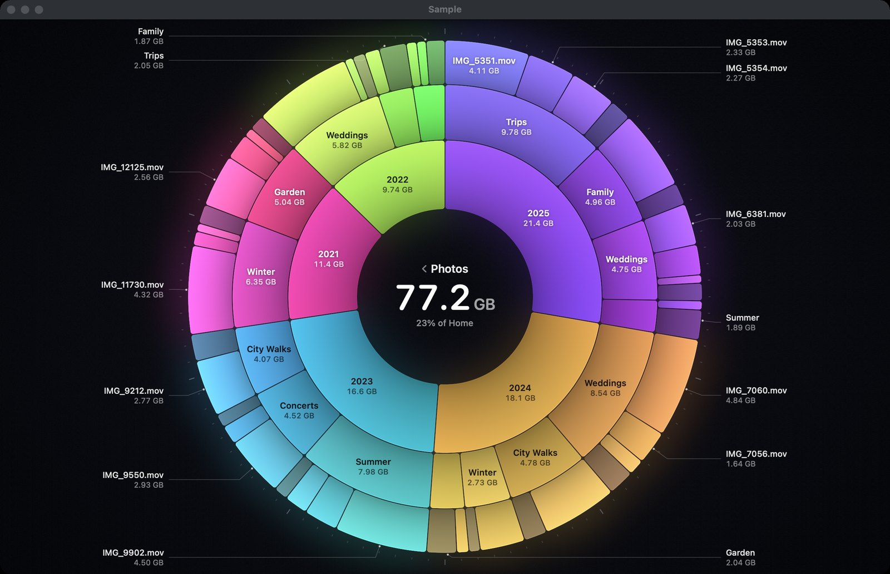

# SunburstKit

A sunburst chart for macOS, drawn with Metal. Any tree, such as a disk, a budget or a library, shown as rings around a
middle, each piece's angle set by its size. Point at a piece to light its branch, click to zoom into it, and click the
middle to go back out.


<sub>The pictures show the example app's made-up sample.</sub>

- **One line to use.** `Sunburst(tree, name: …)` gives the ring, names on and beside it, a readout in the middle, pointing,
  zooming, keys and VoiceOver.
- **Any tree.** It doesn't own your data. Your tree answers a small protocol, and you decide what the colours mean, what's
  marked and what a click opens.
- **Fast.** The layout of a whole 2-million-file disk's top six rings, about 400 pieces, takes a third of a millisecond. The
  layout is generic and `@inlinable`, so your build specialises it for your own tree. Every piece is one instanced quad
  shaped on the GPU, so drawing barely depends on how many there are, and the ring only draws while something moves, on a
  thread of its own.
- **Moves well.** One spring carries every change: a zoom, new sizes arriving while something is measured, new colours.
  Pieces glide from their old place to their new one, and with Reduce Motion they dissolve in place instead.
- **Looks good anywhere.** Colours are worked out in OKLab, each branch gets its own hue from the whole spectrum, and the
  glow uses the extra brightness of an XDR screen when there is one.
- **Can be driven and read from code.** Everything a person does with the pointer has a call, the chart can describe itself
  in words, and it can draw a picture of itself without a window. That's also how agents use it (see `SunburstAgents`).

Requirements: macOS 14 or later, Swift 6.2 or later. No dependencies.

## Install

Add this repository's URL as a package dependency, from version 0.2.0: in Xcode with File › Add Package Dependencies…, or in
`Package.swift` with `.package(url:from:)`. Then add `SunburstKit` to your target's dependencies, and `SunburstAgents` too
if you want agents.

## Quick start

```swift
import SunburstKit
import SwiftUI

struct ContentView: View {
    let tree: FileTree      // yours, conforming to SunburstTree

    var body: some View {
        Sunburst(tree, name: { tree.name(of: $0) })
    }
}
```

Sizes are written in bytes ("4.20 GB") unless you pass `sizeText:`. To show a tree that changes, or to drive the chart from
code, keep a `SunburstChart` and show that:

```swift
@State private var chart = SunburstChart(tree: tree, name: { tree.name(of: $0) })

var body: some View {
    Sunburst(chart)
}

// Anywhere on the main actor:
chart.zoom(into: node)              // into a node; a node with nothing inside is opened instead (onOpen)
chart.zoomOut()                     // one level back out
chart.highlight([a, b], tint: c)    // light these and the way out to them, in one colour
chart.marked = [selected]           // drawn striped
chart.tree = updated                // the same tree with new sizes, as often as they come: everything glides
chart.show(otherTree)               // a different tree: back to its root
chart.onOpen = { node in … }        // a click on a file, say
chart.onKey = { event in … }        // your keys first; return true when handled (Escape and Delete back out)
chart.menu = { node in … }          // a right-click menu, such as Reveal in Finder
chart.onCommandClick = { node in … }
chart.takesKeyboardFocus = true     // keys work without a click first
```

A chart is shown in one view at a time, so give each window its own. What the pointer is on stays lit while sizes,
marks and colours change under it.

The [example app](Examples/FolderMap) is a complete Mac app: it shows a folder, or a made-up sample shaped like a real home
folder, and lets agents in when you ask.
Run it with `swift run` in its folder.



## Your tree: `SunburstTree`

Nodes are `UInt32` numbers. Node 0 is the root, and 0 as a child or a sibling means there is none. Children are listed
biggest first, and things of the same size are drawn in the order you list them, such as by name.

| Member | What it says |
| --- | --- |
| `firstChild(of:)`, `nextSibling(of:)`, `parent(of:)` | The shape of the tree |
| `size(of:)` | Everything in the node: sets its angle |
| `ownSize(of:)` | What the node holds outside its children, drawn with what's too small to draw on its own |
| `isFolder(_:)` | Only folders chain: a folder that's nearly all one subfolder is drawn as one piece with it |
| `style(of:)` | `.folder`, `.file`, `.free` (room not used), `.hidden` (hatched), `.ghost` (faint), `.shared` (a bright dashed outer edge) |
| `nameKey(of:)` | A number from the name, the same from one tree to the next, so pieces glide to their new places |

Optional, with defaults that draw a plain sunburst:

| Member | Default | What it does |
| --- | --- | --- |
| `hasHalves`, `isHalf(_:)` | off | The root is two halves of the ring whatever their sizes, such as one disk beside another |
| `hasBand` | off | A thin band around the middle of the root, with the rings outside it |
| `rootRank(of:)` | 0 | Around the root, lower ranks first, then biggest first |
| `isPlainShape(_:)` | false | A shape of its own in the first ring, such as free space, reaching out as far as the rest does on average |
| `hasGroups`, `group(of:)` | off | Things in a folder are drawn by group first, and a folder that holds more than one group is drawn as a stretch for each |
| `isStillGrowing(_:)` | false | Still being measured: it doesn't chain yet |
| `isAlwaysDrawn(_:)` | false | Drawn as its own piece however thin, never gathered into "smaller items", such as every film in a library |
| `stretches(of:)` | nil | The node's piece cut into stretches side by side, each with its own size, colour and mark, such as by where its files are and which are selected; what's inside is drawn under the whole piece |

## Colours

By default each branch in view gets its own colour from the whole spectrum, a golden angle from the one before, and
everything inside it stays close to that colour, a little lighter each ring out (`BranchColours`). To colour by something
else, such as a file's kind, give the chart a colorer: a colour in linear Display P3 for each node. `Lab` makes good ones.

```swift
chart.colours = { tree, focus in
    { node in Lab(lch: 0.7, 0.15, kindHue(of: node)).linearP3 }
}
```

`BranchColours` can also be painted branch by branch, for rules of your own: `paint(_:hue:)`, `paintQuietly(_:)` for
something that should stay in the background, and `set(_:_:)`.

## Reading it from code

`chart.summary(limit:)` says what's on the ring: the node in the middle, and the biggest pieces with their names, sizes,
shares and where they sit, as a `Codable` value. `chart.picture(width:height:)` draws the ring into a `CGImage` off screen,
without a window: for tests, exports, or an agent that wants to look. With `dithered: false` it leaves out the faint
noise that keeps dark gradients smooth on screen, for a PNG about half the size.

```swift
let summary = chart.summary(limit: 10)
print(summary.name, summary.sizeText)                      // Home 92.0 GB
for piece in summary.pieces { print(piece.name, piece.share) }

let image = chart.picture(width: 1600, height: 1200)       // nil without a GPU
```

## Building your own

`Sunburst` is made of parts you can use directly, for a view of your own:

- `RingLayout.build(tree:focus:colorer:marked:sizes:)` turns part of a tree into `Piece`s, depth first, with how many
  rings to draw (`RingSizes`, `RingStyle`). `piece(of:)`, `hit(angle:radius:)` and `extent(of:)` find pieces in it.
- `SunburstEngine` holds the picture on screen and everything that moves: `apply(_:_:)` with a `RingTransition`,
  `setEmphasis(primary:related:ancestors:tint:)` to light pieces, `setCalm(_:)`, `setGlow(_:)`, `showsScale`.
- `SunburstView` is the `NSView` that draws it, with callbacks for the pointer, keys and VoiceOver; `RingPlace` tells it
  where the ring is on every frame of a SwiftUI animation.
- `LabelPlacer` works out where names fit, inside pieces and beside the ring, and `SunburstLabels` shows them.

## Agents

`SunburstAgents`, a second product in this package, lets AI agents such as Claude Code look at a chart and point at things
on it, over MCP. It's separate, so an app that doesn't use it compiles none of it. Turning it on takes a few lines:

```swift
import SunburstAgents

extension AgentHost {
    static let myApp = AgentHost(
        name: "FolderMap", version: "1.0",
        instructions: "FolderMap shows a folder as a sunburst. Call chart_summary to see what's on it.",
        folder: URL.applicationSupportDirectory.appendingPathComponent("FolderMap"),
        tools: SunburstAgentTools.tools)        // + any tools of your own
}

let door = AgentDoor.open(.myApp) { call in
    try SunburstAgentTools.answer(call, chart: chart)    // or answer your own tools first
}
```

and, as the first thing the program does, `AgentDoor.relayIfAsked(.myApp)`: an agent starts the app's program with
`--mcp`, and from then on that copy only relays between the agent and the running app. `AgentAccessView` shows that
command, ready to copy into an agent's settings (`AgentDoor.command`).

- **The user decides.** An agent gets nothing until the user allows it: `.agentQuestion(door)` asks in the app's window,
  and `AgentAccessView(door)` lists who's asking, who's allowed (to look, or to look and change what's shown), and what
  each agent did. Which program is on the other end, and who signed it, is read from the system, so an agent can't pass
  itself off as another program.
- **Nothing on the network.** The door is a socket file in the app's own folder that only the user can open.
- **The chart's tools:** `chart_summary` (what's on the ring, in words), `chart_picture` (a PNG of it), `chart_zoom_in`,
  `chart_zoom_out`, `chart_highlight` and `chart_clear_highlight`. The last four change what the user sees, so an agent
  allowed only to look can't call them.
- **Your own tools** are `AgentTool`s beside them, answered in the same closure with an `AgentReply`: JSON, text or an
  image.

The example app has an Agents… button that does all of this.

## Working on it

- `swift test` runs the tests. Tests that draw are skipped on a machine without a GPU.
- The shaders' source is `Sources/SunburstKit/Shaders.metal`. They're built into the package as a string, so an app needs no
  resources of its own: after changing them, run `Scripts/embed-shaders.sh`. A test fails until you do.

## Licence

MIT. See [LICENSE](LICENSE).
