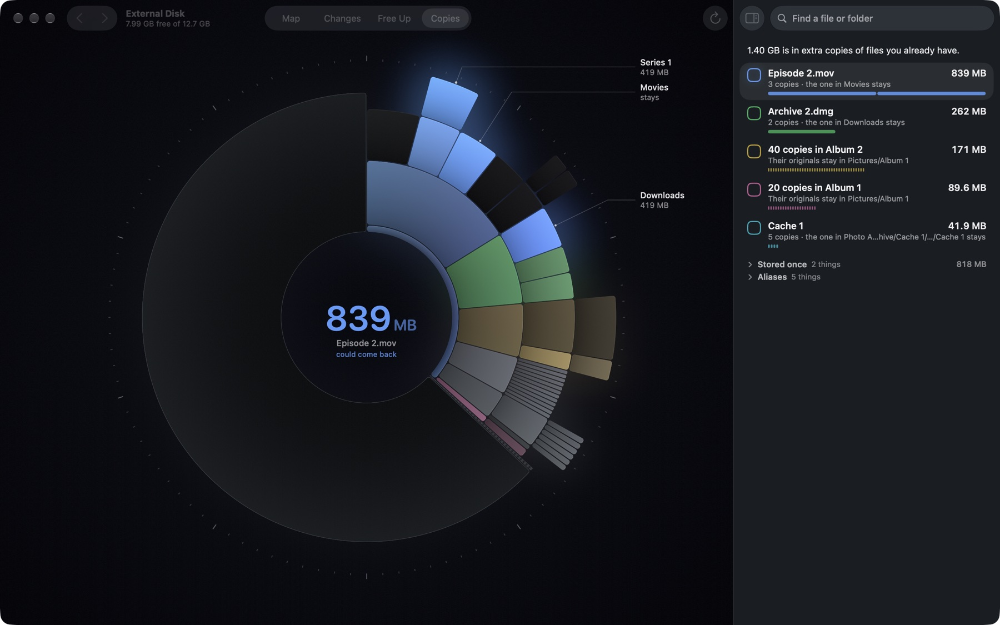

<p align="center">
  
</p>

<p align="center">
  <b>See where your disk space went, and get it back. Fast.</b><br>
  A native Mac app, written in Swift and Metal. Version 0.0.7, an early beta.
</p>


<sub>The names in these screenshots are made up, using `--hide-names`.</sub>

## Fast, all the way through

Headroom reads folder listings in bulk, many entries per call, biggest things first. It adds small files into their
folder instead of keeping each one, and draws the ring on the GPU. The picture is right almost at once, and stays quick
on a disk with millions of files.

Measured on an M5 MacBook Air with 2.1 million files on a 494 GB disk:

| | |
|---|---|
| Opening Headroom again | The map is on screen in about 0.2 s, from the last scan |
| Bringing the map up to date | Only what changed since is read, in about a third of the time it takes to read everything |
| A first launch | Half of the disk is placed in 0.4 s, and about three quarters within a second |
| Rescanning the whole disk (⌘R) | 6.9 s. `du` takes 40 s on the same disk, and collects less |
| Searching every name on the map | 2 to 14 ms per keystroke, across about 324,000 folders and files |
| Sizing up `~/Library`, 376,000 files | 1.7 s |
| Checking 47 items before a clean | 0.35 s, then 9 ms for each one you add |
| Finding duplicates among 465 files of the same sizes, 5.6 GB | 1.3 s, reading straight from the disk at 4.2 GB/s. The next look remembers them |
| Idle | 0% CPU and 130–150 MB of memory |

## Honest about space

- **Reclaimable space, not just size.** Before anything goes, Headroom shows how much space it actually frees, which can
  be far less than a folder's size.
- **Hardlinks and clones count once.** A film in both your library and a torrent folder is one file with two paths, not a
  duplicate. Deleting one path frees nothing: Headroom says so and offers to include the other.
- **The ring adds up to the whole disk.** Free space, macOS, memory swap and whatever can't be read are pieces of their
  own, so nothing is left unexplained.

## Safe by design

- **Nothing is deleted right away.** Everything goes to the Trash first, **Undo** puts it all back, and emptying the Trash
  is always a separate step.
- **Checks before anything moves.** Each item must still exist and not be in use, and anything that doesn't rebuild
  itself must be unchanged since you selected it. If an app is using it, Headroom names the app and lets you decide.
- **Protected locations.** macOS folders, your home folder's standard folders such as Documents and Library, and your
  keychains and mail can't be deleted.
- **Verified moves.** Moving an item to another disk copies it, compares every byte, and only then moves the original to
  the Trash.

## Private

What Headroom reads stays on your Mac. It only goes online to check GitHub for a newer version, at launch or when you
choose Check for Updates, and to download it if you agree. Nothing about your disk is sent. For better suggestions it
reads Plex's watched state, Transmission's torrents, Steam's last-played dates and git, if you have them, and never
writes to them.

## What you can do

### Map

Every folder is a piece of the ring, sized by the space it uses and coloured by the group it belongs to, so related
folders stay together. Point at anything to see its name, size and when it was last used. Click a folder to open it, and
click the middle to go back up.

### Free Up


Things you may want to delete, in boxes named for what they are, biggest first: Caches, Junk, Developer, AI models,
Unused apps, iPhone backups, Old installers, Screenshots and more. A Mac only gets the boxes it has something for.
Open a box to see what's in it, one row per app or thing. **Select recommended** ticks what's safe without a second
thought: caches not in use, and junk. **Largest files**, at the end, lists the biggest files nothing else covers. Point
at a box and its files light up on the ring. Nothing happens until you click **Clean**.

### Changes


What grew since the last scan, or in the last day, week or month. Each piece is coloured by how much of it is new or
changed, from red for a little to yellow for all of it. The middle shows how much free space changed since an earlier
scan, or, without one, the size of the files modified in that time. The inspector lists what grew or was modified in the
folder you're in.

**Untouched** turns it round: what hasn't changed in a month, three months or a year, from deep blue for a little to pale
ice for all of it. An app you opened, a film you watched or a game you played in that time counts as touched, however old
its files are.

### Copies



Duplicates, by content. Each set has its own colour on the ring. Point at a set to see where every copy is, even ones too
small to draw, with the copy to keep marked **Keep**. Open a set to pick a different one to keep, then **Delete**,
**Hardlink** or **Symlink** the rest. Each copy is compared byte for byte first and goes to the Trash on record, so Undo puts
it back. Or tick the set to delete the duplicates with the next Clean. Duplicates of many files in the same folders, such as
an exported photo folder, are one set.

Hardlinks, clones and symlinks are listed below the duplicates; they take no extra space. Files are only read when you open
Copies, and never one that's only in iCloud.

### Search


Press ⌘F and type. Matches are listed as you type, largest first, with their path and size, and light up on the ring.
Search ignores case and accents, in any alphabet.

### A closer look


Press Space on anything for a card: a folder's size and contents, with thumbnails when it's mostly photos or video, or a
file's preview. Click a film to play it in place. The card is a window of its own: move it, resize it, and it reopens
where you left it. It shows when the item was last opened and how much deleting it frees, and for a film its duration,
resolution and frame rate. Select it for Free Up or move it to the Trash from there. The card's item is selected in the
inspector too.

Double-click a file on the ring to open it. Right-click anything to copy its name or path, open it, show it in Finder,
open it in Terminal or move it to the Trash.

## Get started

Headroom requires macOS 26 or later on a Mac with Apple silicon. Download the disk image from [Releases](../../releases),
open it and drag Headroom to Applications. This beta isn't notarized, so macOS blocks the first launch: open
**System Settings → Privacy & Security**, click **Open Anyway** next to Headroom, and open Headroom again.

To build Headroom yourself, clone this repository and use Xcode's command line tools. In the repository's folder:

```bash
./build.sh
open build/Headroom.app
```

On first launch, Headroom shows how to turn on Full Disk Access. Until then it reads nothing at all, so macOS never
prompts about a folder: the ring shows only what the disk itself reports, and the scan starts as soon as access is
granted. A build is signed with a certificate named Headroom if your keychain has one, otherwise with your development
certificate, so the permission survives rebuilds.

When there's a new version, or a newer build of the same version, Headroom offers it at launch and installs it itself.
**Skip This Version** waits for the next one. **Check for Updates…** in the Headroom menu or in About checks at any time.
Every version is signed with the same certificate, so an update keeps Full Disk Access, and Headroom only installs an
update signed with it.

Headroom is a personal project and a showcase, in early beta. It moves real files, so check what it shows before you
click **Clean**.

## Keys

| | |
|---|---|
| ⌘1, ⌘2, ⌘3, ⌘4 | Map, Changes, Free Up, Copies |
| ⇧⌘↑ | Back to the whole disk |
| ⌃⌘I | Show or hide the inspector |
| ⌘F | Search |
| Space | Quick Look |
| Esc | Back out, the way you came in |
| ⌘↑ | Enclosing folder |
| ⌘←, ⌘→ or ⌘[, ⌘] | Back and forward |
| ⌘C, ⌥⌘C | Copy name, copy path |
| ⌘O, ⌥⌘R | Open, show in Finder |
| ⌘⌫ | Select or deselect in Free Up |
| ⌘Z | Undo the last Move to Trash or clean |
| ⌘R | Rescan at full speed |
| Hold ⌥ in Free Up | Preview the disk after cleaning |

Keys apply to what you're pointing at, otherwise to what's selected, otherwise to the folder you're in.

With Reduce Motion on, the ring fades from one picture to the next instead of zooming. VoiceOver reads the ring as a list
of what's in the folder you're in, biggest first, and pressing one does what a click does.

## For developers

How Headroom is designed, with every measurement, is in [DESIGN.md](DESIGN.md).

| Where | What |
|---|---|
| `Model/Scanner.swift` | The scan: `getattrlistbulk` on a thread pool, big things first. A refresh reads only what changed and copies the rest |
| `Model/ChangeJournal.swift` | Which folders changed since a scan, from the record of changes macOS keeps |
| `Advice/Walker.swift` | Looking closely at one folder: its size, newest change, largest file and files with more than one name |
| `Advice/Cleaner.swift` | Everything that touches files, behind one set of checks |
| `Advice/Sections.swift` | The Free Up boxes |
| `Model/Duplicates.swift` | Finding duplicates: same size from the map, then files of a size read side by side in growing pieces |
| `Model/Copies.swift` | Copies: duplicate sets, hardlinks, clones and symlinks, which copy to keep, and their colours |
| `Render/Shaders.metal` | Each piece's shape and light, the glow and the scale |
| `App/Updater.swift` | New versions from GitHub's releases, taken only when signed with the same certificate |

- `swift test` runs the tests, on made-up disks.
- `build/Headroom.app/Contents/MacOS/Headroom --script steps.txt` drives the whole app from a script, without touching
  the mouse. The steps are listed at the top of `App/ScriptRunner.swift`, and a scripted run can only ever clean a
  throwaway disk image named `HeadroomTest`.
- `--hide-names` swaps every folder and file name for a made-up one, for screenshots. With `--script`, put it last.
- `--no-cache` starts without the saved scan, to see what a first launch looks like.
- `--locked`, with `--script`, acts as if Full Disk Access were off, to see what that looks like.
- `--reduce-motion` acts as if Reduce Motion were on, whatever System Settings says.
- `--demo-scale 200` and `--demo-disks /a:/b`, with `--script`, are for recording a demo on made-up disk images: every size
  is multiplied, so a few gigabytes read as a full Mac, and only those disks are listed.
- `--remember-window`, with `--script`, keeps the window, the inspector and the view between runs, in your own settings.
- `./release.sh` makes the release disk image, signed with the certificate called Headroom, and a small file beside it
  with its version and build number. Both go on the release: a copy that updates itself compares build numbers, so a
  release put out again under the same version still reaches it. A release signed any other way would be turned down by
  every copy that updates itself.
- The app icon is an Icon Composer document, `Resources/AppIcon.icon`. After changing it, run `Resources/make-icon.sh`.
