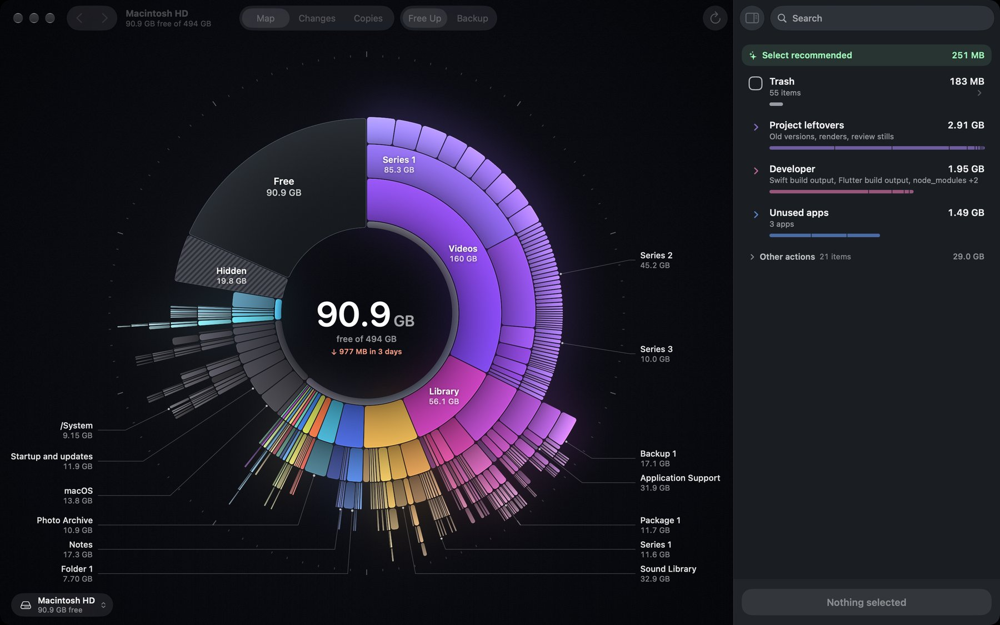
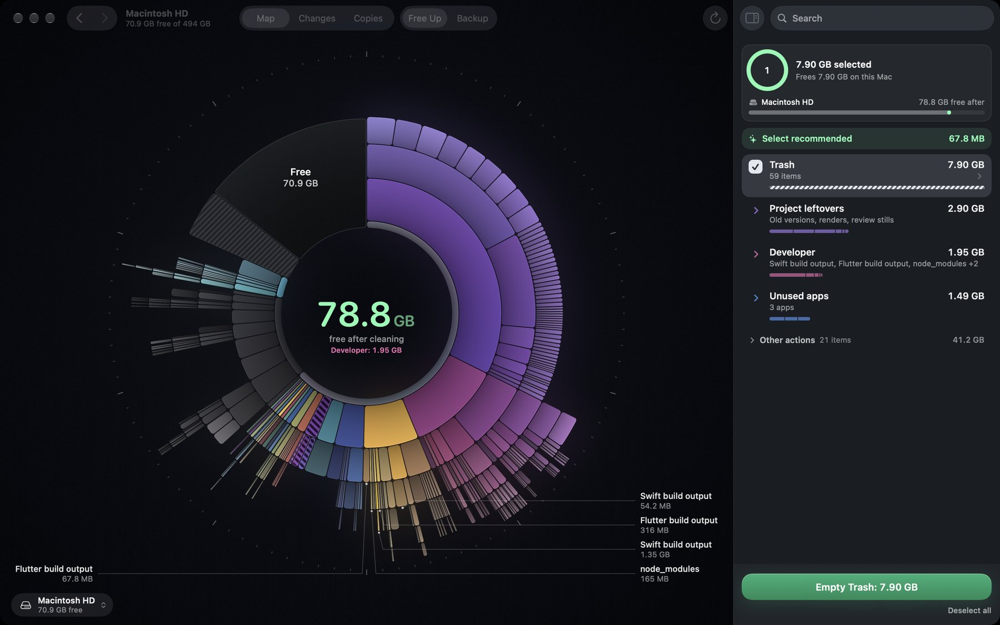
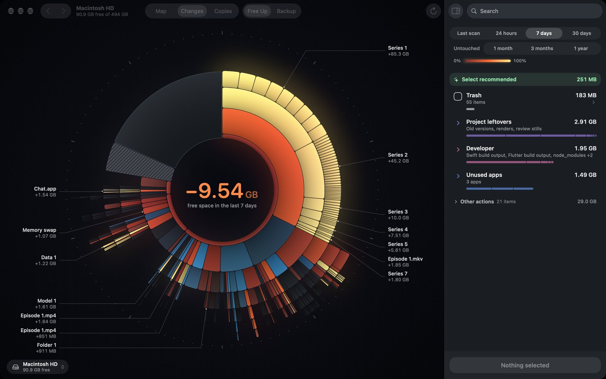
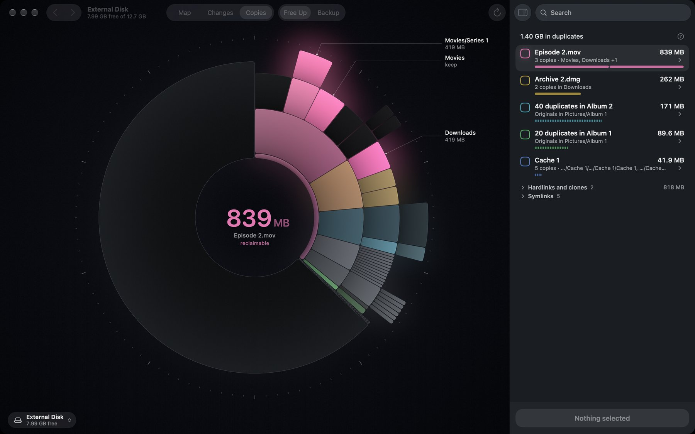
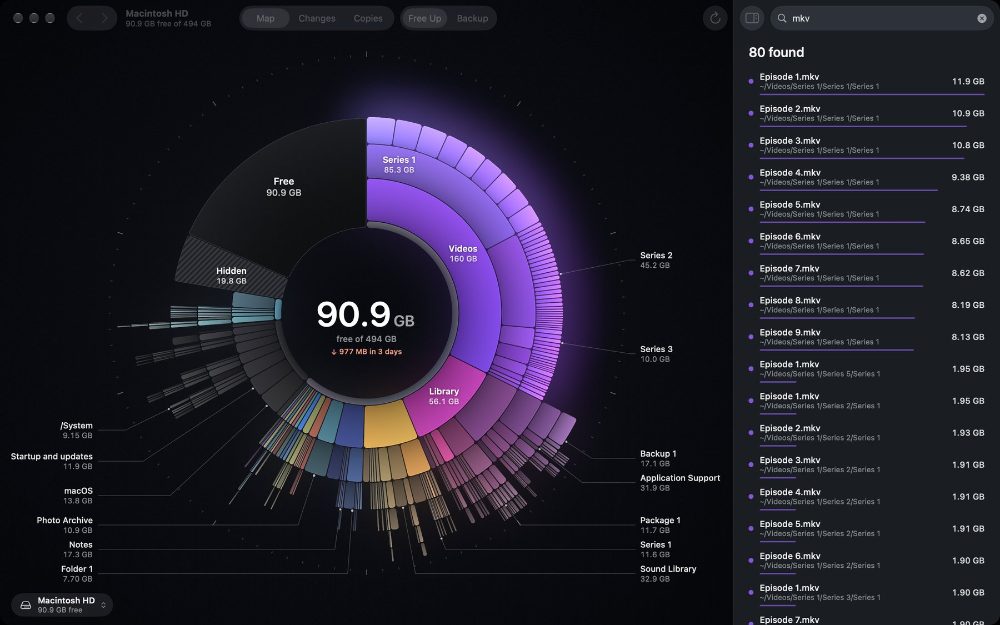
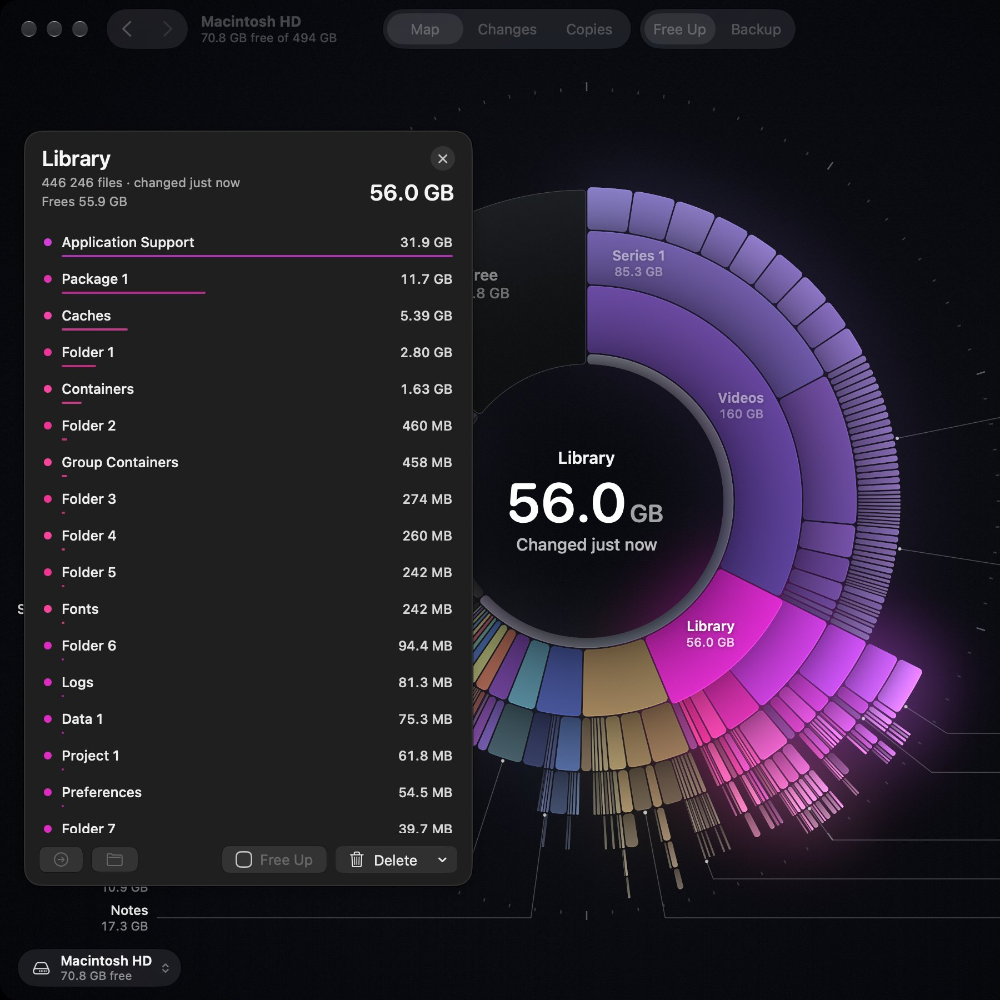
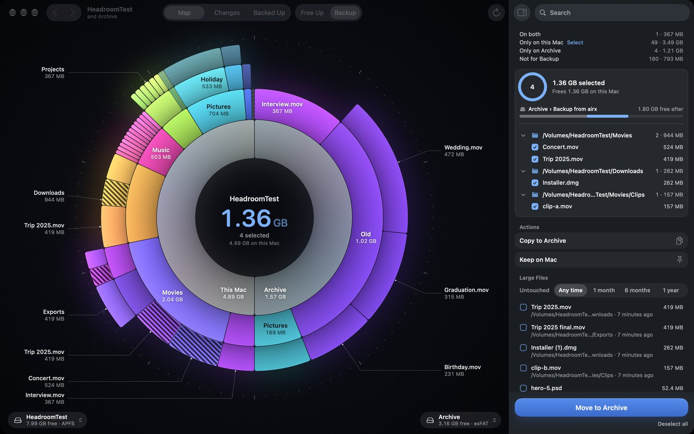

<p align="center">
  
</p>

<p align="center">
  <b>See where your disk space went, and get it back. Fast.</b><br>
  A native Mac app, written in Swift and Metal. Version 0.0.10, an early beta.
</p>



<sub>The names in these screenshots are made up, with `--hide-names` or on a throwaway test disk.</sub>

## Fast, all the way through

Headroom reads folder listings in bulk, many entries per call, largest first. It adds small files into their folder's
total instead of keeping each one, and draws the map on the GPU. The map takes shape almost at once and stays fast on a
disk with millions of files.

Measured on an M5 MacBook Air with 2.1 million files on a 494 GB disk:

| | |
|---|---|
| Opening Headroom again | The map is on screen in about 0.2 s, from the last scan |
| Bringing the map up to date | Only what changed is rescanned, in about a third of the time of a full scan |
| A first launch | Half of the disk is on the map in 0.4 s, and about three quarters within a second |
| Rescanning the whole disk (⌘R) | 6.9 s. `du` takes 40 s on the same disk, and collects less |
| Searching every file and folder name | 2 to 14 ms per keystroke, across about 324,000 folders and files |
| Sizing up `~/Library`, 376,000 files | 1.7 s |
| Checking 47 items before a clean | 0.35 s, then 9 ms for each one you add |
| Finding duplicates among 465 files of the same sizes, 5.6 GB | 1.3 s, reading straight from the disk at 4.2 GB/s. Later checks reuse the results |
| Idle | 0% CPU and 130–150 MB of memory |

## Honest about space

- **Reclaimable space, not just size.** Before anything goes, Headroom shows how much space it actually frees, which can
  be far less than a folder's size.
- **Hardlinks and clones count once.** A film in both your library and a torrent folder is one file with two paths, not a
  duplicate. Deleting one path frees nothing: Headroom says so and offers to include the other.
- **The map adds up to the whole disk.** Free space, macOS, memory swap and the space Headroom can't read are on the map
  too, so all of the disk is accounted for.

## Safe by design

- **Nothing is deleted right away.** Everything goes to the Trash first, **Undo** puts it all back, and emptying the Trash
  is always a separate step.
- **Checks before anything moves.** Each item must still exist and not be in use, and anything that doesn't rebuild
  itself must be unchanged since you selected it. If an app is using it, Headroom names the app and lets you decide.
- **Nothing is selected for you.** Nothing is ticked until you tick it or click Select recommended.
- **Protected locations.** macOS folders, your home folder's standard folders such as Documents and Library, and your
  keychains and mail can't be deleted.
- **Verified moves.** Moving an item to another disk copies it, compares every byte, and only then moves the original to
  the Trash.

## Private

What Headroom reads stays on your Mac. It only goes online to check GitHub for a newer version, at launch or when you
choose Check for Updates, and to download it if you agree. Nothing about your disk is sent. For better suggestions it
reads Plex's watched state, Transmission's torrents, Steam's last-played dates and git, if you have them, and never
writes to them.

## What you can do

The toolbar has two pickers. The view (**Map**, **Changes** or **Copies**) sets what the map shows. The mode (**Free Up**
or **Backup**) sets the inspector, what Space selects and the button at the bottom. Each mode keeps its own selection.
Clicking a folder on the map opens it, in every view and mode. Clicking a file shows it in the inspector.

### Map

Each folder is a segment of the map, sized by the space it uses and coloured by the group it belongs to, so related
folders stay together. Point to an item to see its name, size and when it was last used. Click a folder to open it, and
click the centre of the map to go back up.

### Free Up



Free Up lists what you may want to delete, in categories, largest first: Caches, Junk, Developer, AI models, Unused
apps, iPhone backups, Old installers, Screenshots and more. Only categories with something in them are shown. Open a
category to see its items, one row per app or item. **Select recommended** ticks what's safe to delete: caches not in
use, and junk. **Largest files**, at the end, lists the largest files no category covers. Point to a category to
highlight its files on the map. To select an item on the map, point to it and press Space. What's selected is summed up
at the top: its size, the space it frees, and the disk's free space after. Nothing happens until you click **Clean**.
Then the top shows what went to the Trash: **Delete permanently** frees the space, and **Undo** puts it all back.

### Changes



Changes shows what grew since the last scan, or in the last day, week or month. Each folder and file is coloured by how
much of it is new or changed, from red for a little to yellow for all of it. The centre of the map shows how much free
space changed since an earlier scan. Without an earlier scan, it shows the size of the files modified in that time.
Choose the time period at the top of the inspector.

**Untouched** shows the opposite: what hasn't changed in a month, three months or a year, from deep blue for a little to
pale blue for all of it. An app you opened, a film you watched or a game you played in that time counts as touched, however old
its files are.

### Copies



Copies finds duplicate files by content. Each set has its own colour on the map, and in Free Up the inspector lists the
sets. Point to a set to highlight every copy on the map, even ones too small to see, with the copy to keep marked
**Keep**. Open a set to choose a different copy to keep, then **Delete**, **Hardlink** or **Symlink** the rest. Each copy
is compared byte for byte first, and Undo puts it back. Or tick the set to delete the duplicates with the next Clean.
Duplicates of many files in the same folders, such as an exported photo folder, are grouped as one set.

Hardlinks, clones and symlinks are listed below the duplicates. They take no extra space. Copies reads files only when
you open it, and never reads a file that's only in iCloud.

### Search



Press ⌘F and type. Matches are listed as you type, largest first, with their path and size, and highlighted on the map.
Search ignores case and accents, in any alphabet.

### Quick Look



Point to an item and press Shift-Space to open Quick Look. It shows a folder's size and contents, with thumbnails when
it's mostly photos or video, or a preview of a file. Click a film to play it. Move or resize the Quick Look window, and it
reopens where you left it. Quick Look shows when the item was last opened and how much deleting it frees, and for a film
its duration, resolution and frame rate. You can select the item for Free Up or move it to the Trash from there. The
inspector shows the same item.

Double-click a file on the map to open it. Right-click an item to copy its name or path, open it, show it in Finder,
open it in Terminal or move it to the Trash.

### Backup



Backup moves files of 10 MB or more to another drive and leaves a small note in place of each. Choose the backup
location at the bottom right, select files in the list or on the map, and click **Move**. On the drive, each file goes in a
folder named for the Mac, at its full path: `/Users/you/Downloads/F.mkv` from a Mac named Studio lands at `Backup from
Studio/Users/you/Downloads/F.mkv`. Each file is copied and verified against its SHA-256 before the original goes to the
Trash. Undo puts it back until you empty the Trash. The note, `name.hrmoved`, is plain text saying where the file went and
its SHA-256. Nothing else goes on the drive: on a large exFAT drive every small file takes 128 KB.

With a location chosen, Backup shows a side-by-side map: the folder you're in on this Mac on the left, and the same
folder in the backup folder on the right, without free space. At the top level, it's the whole disk beside the whole
backup folder. Click one side to see it alone, a folder to open it on both sides, and the centre of the map to go back
up. Pointing to an item highlights its copy on the other side. In the Map view, both sides have the usual colours.
**Backed Up**, which replaces Copies in Backup, colours each file by where it is: on both, only on this Mac, only on the
drive, moved, or not for Backup (under 10 MB, or part of macOS or an app). A folder with files in more than one place is
split into one part per place. Moved files are drawn as outlines where they were. Headroom reads the backup folder each
time the drive is connected. While it's disconnected, its side shows what was there last time, dimmed.

To select a file or folder, point to it on either side and press Space, or tick it in the list. What's selected is summed
up at the top: its size, the space it frees on this Mac, where it goes and the free space left there, and the files by
folder. The button at the bottom does the main action, Move or Copy to Mac, and the panel lists the other actions that
apply: Copy, Keep on Mac, Verify, Delete. While files move, the summary shows the progress, file by file. **Select**
beside "Only on this Mac" selects everything the drive doesn't have. Delete checks this Mac and the drive again first, and
keeps the drive's copy if this Mac's copy is different. From the Moved list you can move a file back, verify it or delete it from
the drive. A file can be on Free Up's list or Backup's, never both.

### Agents

An AI agent such as Claude Code can look through your disk with its own tools and select in Headroom what it thinks can
go, so you see it on the map and decide. Add Headroom to the agent as an MCP server, with the command shown under
**Headroom → Agents…**. The first time an agent connects, Headroom asks you: **Allow**, **Look Only** or **Don't Allow**.

What an agent selects is listed in Free Up under its name, largest first, with its reason beside each item. It's told
what removing each item really frees, and which other copies a hardlinked file has. It can also select big files for
Backup and choose its drive. An agent can't delete or move anything: it has no command that removes, empties the Trash
or presses Clean or Move. Those are always your clicks.

## Get started

Headroom requires macOS 26 or later on a Mac with Apple silicon. Download the disk image from [Releases](../../releases),
open it and drag Headroom to Applications. This beta isn't notarized, so macOS blocks the first launch: open
**System Settings → Privacy & Security**, click **Open Anyway** next to Headroom, and open Headroom again.

To build Headroom yourself, clone this repository and use Xcode's command line tools. In the repository's folder:

```bash
./build.sh
open build/Headroom.app
```

On first launch, Headroom shows how to turn on Full Disk Access. Until then it reads nothing at all, so macOS never
asks about a folder. The map shows only what the disk itself reports, and the scan starts as soon as access is
granted. A build is signed with a certificate named Headroom if your keychain has one, otherwise with your development
certificate, so the permission survives rebuilds.

When there's a new version, or a newer build of the same version, Headroom offers it at launch and installs it itself.
**Skip This Version** waits for the next one. **Check for Updates…** in the Headroom menu or in About checks at any time.
Every version is signed with the same certificate, so an update keeps Full Disk Access, and Headroom only installs an
update signed with it.

Headroom is a personal project and a showcase, in early beta. It moves real files, so check what it shows before you
click **Clean**.

## Keys

| | |
|---|---|
| ⌘1, ⌘2, ⌘3 | Map, Changes, Copies (Backed Up in Backup) |
| ⌘4, ⌘5 | Free Up, Backup |
| ⇧⌘M | Show moved files (in Backup) |
| ⇧⌘↑ | Back to the whole disk |
| ⌃⌘I | Show or hide the inspector |
| ⌘F | Search |
| Space | Select or deselect the item you're pointing to (in Backup, a folder's files) |
| Shift-Space | Quick Look |
| Esc | Back out, the way you came in |
| ⌘↑ | Enclosing folder |
| ⌘←, ⌘→ or ⌘[, ⌘] | Back and forward |
| ⌘C, ⌥⌘C | Copy name, copy path |
| ⌘O, ⌥⌘R | Open, show in Finder |
| ⌘⌫ | Select or deselect in Free Up, or for Backup |
| ⌘Z | Undo the last Move to Trash or clean |
| ⌘R | Rescan at full speed |
| Hold ⌥ in Free Up | Preview the disk after cleaning |

Keys apply to the item you're pointing to, otherwise to what's selected, otherwise to the folder you're in.

With Reduce Motion on, the map fades between folders instead of zooming. VoiceOver reads the map as a list of what's in
the folder you're in, largest first. Activating an item does the same as clicking it.

## For developers

How Headroom is designed, with every measurement, is in [DESIGN.md](DESIGN.md).

| Where | What |
|---|---|
| `Model/Scanner.swift` | The scan: `getattrlistbulk` on a thread pool, big things first. A refresh reads only what changed and copies the rest |
| `Model/ChangeJournal.swift` | Which folders changed since a scan, from the record of changes macOS keeps |
| `Advice/Walker.swift` | Looking closely at one folder: its size, newest change, largest file and files with more than one name |
| `Advice/Cleaner.swift` | Everything that touches files, behind one set of checks |
| `Advice/Sections.swift` | The Free Up categories |
| `Model/Duplicates.swift` | Finding duplicates: files of the same size from the map, then compared in growing chunks |
| `Model/Copies.swift` | Copies: duplicate sets, hardlinks, clones and symlinks, which copy to keep, and their colours |
| `Packages/SunburstKit` | The sunburst chart: layout, Metal drawing, animation and labels, as a separate package ([README](Packages/SunburstKit/README.md)) |
| `UI/Kit` | The shared controls: ticks, buttons, pickers, cards, file rows and folds, so a change to one reaches every use |
| `App/Updater.swift` | New versions from GitHub's releases, taken only when signed with the same certificate |

- `swift test` runs the tests, on made-up disks. `swift test --package-path Packages/SunburstKit` runs the ring's own.
- `build/Headroom.app/Contents/MacOS/Headroom --script steps.txt` drives the whole app from a script, without touching
  the mouse. The steps are listed at the top of `App/ScriptRunner.swift`, and a scripted run can only ever clean a
  throwaway disk image named `HeadroomTest`.
- `--hide-names` swaps every folder and file name for a made-up one, for screenshots. With `--script`, put it last.
- `--no-cache` starts without the saved scan, to see what a first launch looks like.
- `--locked`, with `--script`, acts as if Full Disk Access were off, to see what that looks like.
- `--reduce-motion` acts as if Reduce Motion were on, whatever System Settings says.
- `--demo-scale 200` and `--demo-disks /a:/b`, with `--script`, are for recording a demo on made-up disk images: every size
  is multiplied, so a few gigabytes read as a full Mac, and only those disks are listed.
- `--remember-window`, with `--script`, keeps the window, the inspector and the view between runs, in your own settings.
- `./release.sh` makes the release disk image, signed with the certificate called Headroom, and a small file beside it
  with its version and build number. Both go on the release: a copy that updates itself compares build numbers, so a
  release put out again under the same version still reaches it. A release signed any other way would be turned down by
  every copy that updates itself.
- The app icon is an Icon Composer document, `Resources/AppIcon.icon`. After changing it, run `Resources/make-icon.sh`.
