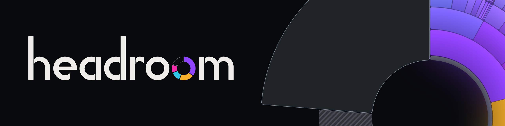
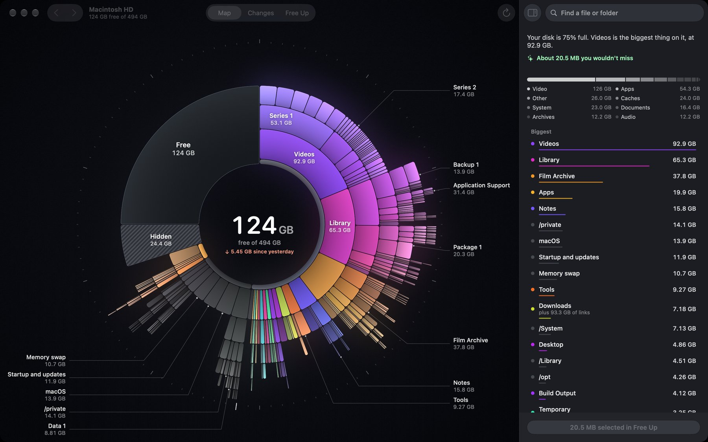
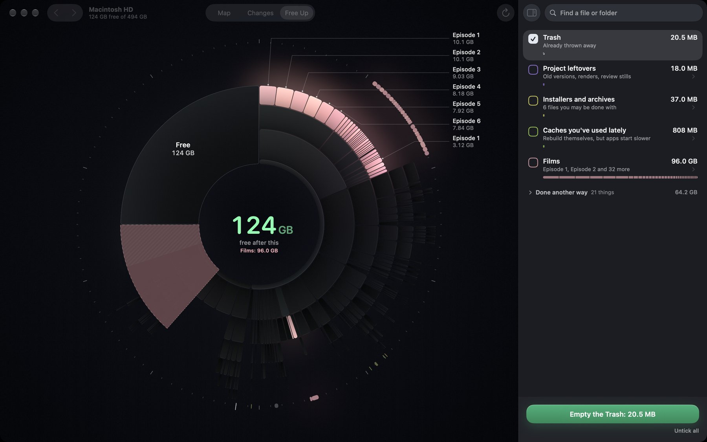
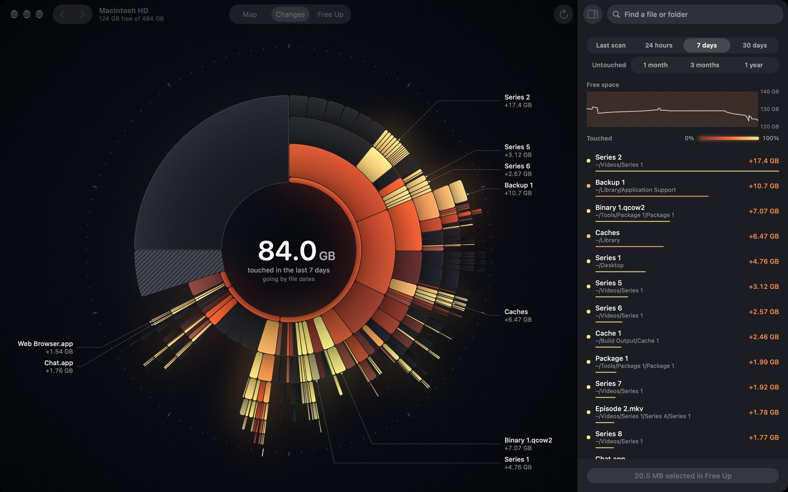
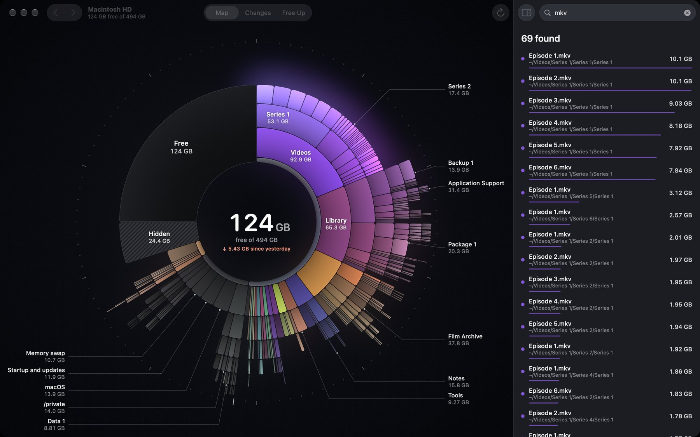
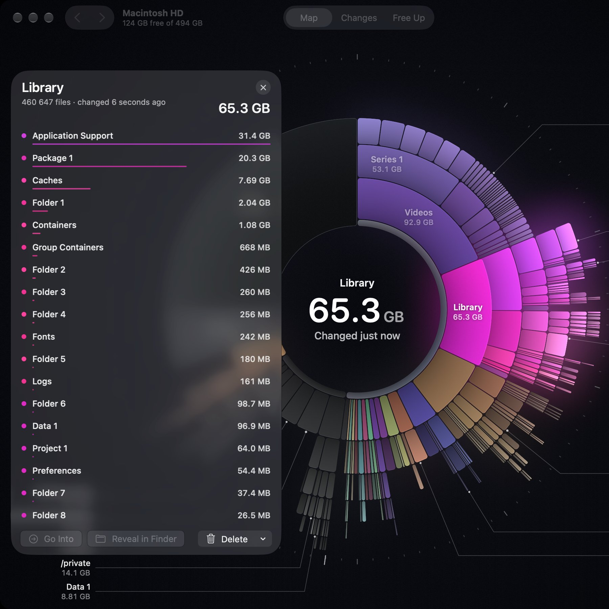

<p align="center">
  
</p>

<p align="center">
  <b>See where your disk space went, and get it back. Fast.</b><br>
  A native Mac app, written in Swift and Metal. Version 0.0.5, an early beta.
</p>



<sub>The names in these screenshots are made up, using `--hide-names`.</sub>

## Fast, all the way through

Headroom reads folder listings in bulk, many entries per call, biggest things first. It adds small files into their
folder instead of keeping each one, and draws the ring on the GPU. The picture is right almost at once, and stays quick
on a disk with millions of files.

Measured on an M5 MacBook Air with 2.1 million files on a 494 GB disk:

| | |
|---|---|
| Opening Headroom again | The map is on screen in about 0.2 s, from the last scan |
| Bringing the map up to date | Only what changed since is read, in about a third of the time it takes to read everything |
| A first launch | Half of the disk is placed in 0.4 s, and about three quarters within a second |
| Reading the whole disk again (⌘R) | 6.9 s. `du` takes 40 s on the same disk, and collects less |
| Searching every name on the map | 2 to 14 ms per keystroke, across about 324,000 folders and files |
| Sizing up `~/Library`, 376,000 files | 1.7 s |
| Checking 47 things before a clean | 0.35 s, then 9 ms each time you tick one more |
| Sitting open | 0% CPU and 130–150 MB of memory |

## Honest about space

- **What you'd really get back.** Before anything goes, Headroom says how much space you'd really get back, which can be
  far less than a folder's size.
- **Hard links and clones count once.** A film that's both in your library and in a torrent folder is one file with two
  names, not a duplicate. Removing one of the names frees nothing, and Headroom says so, then offers the other name too.
- **The ring adds up to the whole disk.** Free space, macOS, memory swap and whatever can't be read are pieces of their
  own, so nothing is left unexplained.

## Safe by design

- **Nothing is deleted straight away.** Everything goes to the Trash first, **Undo** puts it all back, and emptying the
  Trash is always a click of its own.
- **Checks before anything moves.** Headroom makes sure each thing is still there and isn't being used by a program,
  and that anything which doesn't rebuild itself hasn't changed since you picked it. If a program is using it, Headroom
  says which one and lets you decide.
- **Protected places.** macOS's own folders, your home folder's standard folders such as Documents and Library, and
  places like your keychains and mail can't be removed.
- **Moves you can trust.** Moving something to another disk copies it, reads every byte back to compare, and only then
  sends the original to the Trash.

## Private

What Headroom reads stays on your Mac. The only time it goes online is to ask GitHub whether there's a newer version, at
launch or when you choose Check for Updates, and to download it if you say yes. Nothing about your disk goes with the
question. To say more about what's yours, it reads Plex's watched state, Transmission's torrents, Steam's last played
dates and git, if you have them, and only ever reads.

## What you can do

### Map

Every folder is a piece of the ring, sized by the space it takes and coloured by what it belongs to, so whatever belongs
together stays together. Point at anything to see its name, its size and when you last used it. Click a folder to go
into it, and click the middle to go back up.

### Free Up



A short stack of boxes, with what you'd miss least on top: caches and build output, installers and archives, project
leftovers, episodes you've watched, apps you don't use and more. Point at a box and its files light up on the ring. Tick a
box to select everything in it, or open the box to pick one thing at a time. Nothing happens until you press **Clean**.

### Changes



What grew since the last scan, or in the last day, week or month. Each piece is coloured by how much of it is new or
changed, red for a little and yellow for all of it. The middle says how much free space changed, when there's an earlier
scan to compare with, or otherwise how much was touched, going by file dates. The inspector lists what grew or was touched
in the folder you're in.

Or the other way round: what nothing has changed in for a month, three months or a year, deep blue for a little and
pale ice for all of it. An app you opened, a film you watched or a game you played in that time counts as touched,
however old its files are.

### Search



Press ⌘F and type. The matches are listed as you type, biggest first, each with its path and size, and they light up on
the ring. Capitals and accents don't matter, in any alphabet.

### A closer look



Press Space on anything for a card: a folder's size and what's inside, with pictures when the folder is mostly photos or
video, or a file's own preview. Double-click a file on the ring to open it. Right-click anything to copy its name or path,
open it, reveal it in the Finder, open it in Terminal or send it to the Trash.

## Get started

Headroom needs macOS 26 or later on a Mac with Apple silicon. Download the disk image from [Releases](../../releases),
open it and drag Headroom to Applications. This beta isn't notarized by Apple, so the first time you open Headroom, macOS
stops it. Open **System Settings → Privacy & Security**, click **Open Anyway** next to Headroom, and open Headroom again.

To build Headroom yourself, clone this repository and use Xcode's command line tools. In the repository's folder:

```bash
./build.sh
open build/Headroom.app
```

The first time, Headroom explains what macOS keeps private and shows you where to switch on Full Disk Access. Until then
it reads nothing at all, so macOS never asks you about a folder: the ring shows only what the disk itself reports, and
Headroom reads the whole disk the moment it may. A build is signed with a certificate called Headroom if your
keychain has one, and otherwise with your development certificate if you have one, so the permission survives rebuilds.

When there's a new version, Headroom says so at launch and can put it in place itself. Say Not This Version and it waits
for the one after. **Check for Updates…** in the Headroom menu, or in About, looks again whenever you like. Every
version is signed with the same certificate, so an update keeps Full Disk Access, and Headroom only takes an update
signed with it.

Headroom is a personal project and a showcase, in an early beta. Headroom moves real files, so read what it tells you
before you press **Clean**.

## Keys

| | |
|---|---|
| ⌘1, ⌘2, ⌘3 | Map, Changes, Free Up |
| ⇧⌘↑ | Back to the whole disk |
| ⌃⌘I | Show or hide the inspector |
| ⌘F | Find a file or folder |
| Space | A closer look at what you're pointing at |
| Esc | Back out, the way you came in |
| ⌘↑ | The folder this one is in |
| ⌘[, ⌘] | Back and forward through where you've been |
| ⌘C, ⌥⌘C | Copy the name, or the path |
| ⌘O, ⌥⌘R | Open, or reveal in the Finder |
| ⌘⌫ | Select or unselect it in Free Up |
| ⌘Z | Undo the last Send to Trash or clean |
| ⌘R | Read the disk again, at full power |
| Hold ⌥ in Free Up | See the disk as it will be afterwards |

Keys apply to what you're pointing at, otherwise to what's selected, otherwise to the folder you're in.

With Reduce Motion on, the ring fades from one picture to the next instead of zooming. VoiceOver reads the ring as a list
of what's in the folder you're in, biggest first, and pressing one does what a click does.

## For developers

How Headroom is designed, with every measurement, is in [DESIGN.md](DESIGN.md).

| Where | What |
|---|---|
| `Model/Scanner.swift` | The scan: `getattrlistbulk` on a thread pool, big things first. A refresh reads only what changed and copies the rest |
| `Model/ChangeJournal.swift` | Which folders changed since a scan, from the record of changes macOS keeps |
| `Advice/Walker.swift` | Looking closely at one folder: its size, newest change, largest file and files with more than one name |
| `Advice/Cleaner.swift` | Everything that touches files, behind one set of checks |
| `Advice/Sections.swift` | The Free Up boxes |
| `Render/Shaders.metal` | Each piece's shape and light, the glow and the scale |
| `App/Updater.swift` | New versions from GitHub's releases, taken only when signed with the same certificate |

- `swift test` runs the tests, on made-up disks.
- `build/Headroom.app/Contents/MacOS/Headroom --script steps.txt` drives the whole app from a script, without touching
  the mouse. The steps are listed at the top of `App/ScriptRunner.swift`, and a scripted run can only ever clean a
  throwaway disk image named `HeadroomTest`.
- `--hide-names` swaps every folder and file name for a made-up one, for screenshots. With `--script`, put it last.
- `--no-cache` starts without the saved scan, to see what a first launch looks like.
- `--locked`, with `--script`, acts as if Full Disk Access were off, to see what that looks like.
- `--reduce-motion` acts as if Reduce Motion were on, whatever System Settings says.
- `--remember-window`, with `--script`, keeps the window, the inspector and the view between runs, in your own settings.
- `./release.sh` makes the release disk image, signed with the certificate called Headroom. A release signed any other
  way would be turned down by every copy that updates itself.
- The app icon is an Icon Composer document, `Resources/AppIcon.icon`. After changing it, run `Resources/make-icon.sh`.
