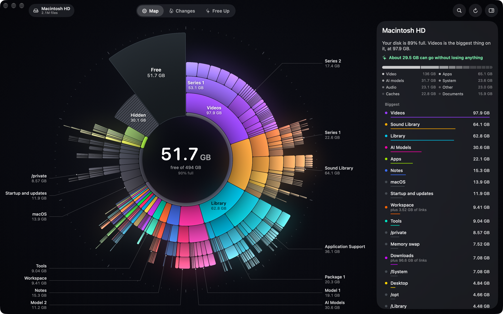

# Headroom

Shows where your disk space went and how to get it back. A native Mac app in Swift and Metal.



*The folder names in this screenshot are made up, using `--hide-names`.*

The design thinking is in [DESIGN.md](DESIGN.md).

## Run it

Requires macOS 26 or later and Xcode's command line tools.

```bash
./build.sh
open build/Headroom.app
```

The first time, the ring shows a hatched "Hidden" piece, because macOS keeps Downloads, Desktop, Documents and a few
others private. Click **Allow Full Disk Access** and switch Headroom on in the pane that opens. The app is signed with
your development certificate if you have one, so the permission survives rebuilds.

After that, the last scan appears as soon as the window opens, and a refresh runs quietly at low priority. To see what
a first launch looks like, quit the app and start it without the saved scan:

```bash
open build/Headroom.app --args --no-cache
```

To take a screenshot without showing what's on your disk, start it with `--hide-names`. That swaps folder and file names in
the Map for made-up ones, and turns off moving anything to the Trash.

## How to use it

- **Map** shows what's on the disk. Colour shows what belongs together: each big thing has its own colour, and
  everything inside it stays close to that colour. Point at anything to see its name, its size and what you'd really
  get back. Click to zoom in, and click the middle (or press Esc) to go back.
- **Changes** shows what has grown. It lights up in heat colours and lists the folders responsible. It reads file dates
  on the first day, then compares scans as history builds up.
- **Free Up** is a short stack of boxes, with what you'd miss least on top. Each box is one kind of thing, such as caches,
  AI models or project leftovers, and its bar shows how big it is and what it's made of. The list and the ring are the same
  data shown two ways: each box's files wear its colour, pointing at a box lights them up, and pointing at the ring lights
  the box. Tick a box to select everything in it, click a piece of its bar to select one thing, or open it for full
  control. Inside a folder, the boxes are for what's in that folder. Striped pieces are selected, and nothing happens until
  you press **Clean**. Whatever needs a look shows at the top with a way to fix it. It all goes to the Trash, and **Undo**
  puts it back. The space comes back when you empty it, which is always its own click. Apps go through the Finder, so the
  first uninstall brings up one macOS question, and some apps ask for your password.

Things that help it say more, if you have them: Plex's watched state, Transmission's torrents, Steam's last played, and git.
They're only ever read, and nothing leaves your Mac.

| Keys | |
|---|---|
| ⌘1, ⌘2, ⌘3 | Map, Changes, Free Up |
| Esc or ⌘[ | Back |
| Space | Quick Look what you're pointing at |
| ⌘F | Find a file or folder |
| ⌘R | Scan again, at full power |
| Right-click | Reveal in Finder, Quick Look, Copy Path, select it, move it to another disk |
| Pinch | Zoom in and out |

In Free Up:

| | |
|---|---|
| Click, double-click a piece | Select it, or take it out. Open it |
| ↑ ↓ | Step through the boxes, with the ring following |
| Delete | Tick the current box, or untick it |
| K | Keep it: take it out and stop suggesting it, on a box that's one thing |
| M | Move it to another disk, on a box that's one thing |
| Space | Quick Look |
| Return | Clean |
| Hold Option | See the disk as it will be afterwards |

## What the numbers mean

- Sizes are space on disk. Hard links and identical APFS clones count once, in the place you'd think of as home.
- **"You'd get back"** can be far less than a folder's size. If a folder's files are also linked from somewhere else,
  removing that folder alone frees nothing. The panel says where the other copies are.
- The ring always adds up to the whole disk. Whatever can't be read is the hatched Hidden piece.
- Partly changed clones are counted in full, so a folder of them can look slightly bigger than it is.
- During a first scan, a size with dots (`64 GB…`) may still grow, and the hatched piece says "Still reading". Zooming
  into a folder reads it first.

## How it's built

| Where | What |
|---|---|
| `Model/Scanner.swift` | The scan: `getattrlistbulk` on a thread pool, big things first, then the rest at low priority |
| `Model/Volume.swift` | The disk's own numbers, the top of the tree, the scan's two speeds, and hard-link and clone accounting |
| `Model/Rules.swift` | What Headroom knows about particular folders, and how safe each is to remove |
| `Model/Insights.swift` | Suggestions from the folder rules, Changes rows, and the colours for each view |
| `Model/AppModel+Plan.swift` | What's selected: choosing, pointing, checking, cleaning, undo and emptying |
| `Advice/Sections.swift` | The boxes: every suggestion sorted by what it is, leftovers found by name and contents, and what's in the picture on screen |
| `Advice/Plan.swift` | The list of what's selected and what it does to the numbers. No file is touched here |
| `Advice/Cleaner.swift` | Everything that touches files, behind one check, and the checks before a clean |
| `Advice/Advisors.swift` | Suggestions about whole things: a series, an app, a project |
| `Advice/Facts.swift` | Spotlight and other apps' records, read in the background |
| `Model/History.swift` | The saved last scan, snapshots for comparison, free-space history |
| `Render/Layout.swift` | Turns part of the tree into pieces of a ring |
| `Render/RingColours.swift` | The Map view's colours, and remembering which folder has which |
| `Render/MapEngine.swift` | Transitions: where each piece starts and ends, and one spring that carries them |
| `Render/Shaders.metal` | Each piece's shape and light, the glow and the scale. macOS compiles this at launch |
| `UI/` | Labels, the centre readout, and the glass panels |

To check the whole interface without touching the mouse, run the app with a script. The steps are listed at the top of
`App/ScriptRunner.swift`. A scripted run keeps its data apart from yours, and its clean, empty and undo steps can only
ever act on a throwaway disk image named `HeadroomTest`.

```bash
build/Headroom.app/Contents/MacOS/Headroom --script steps.txt
```

The logic behind the suggestions and the plan has automated tests, on made-up disks:

```bash
swift test
```

To redraw the app icon, run `Resources/make-icon.sh`.
